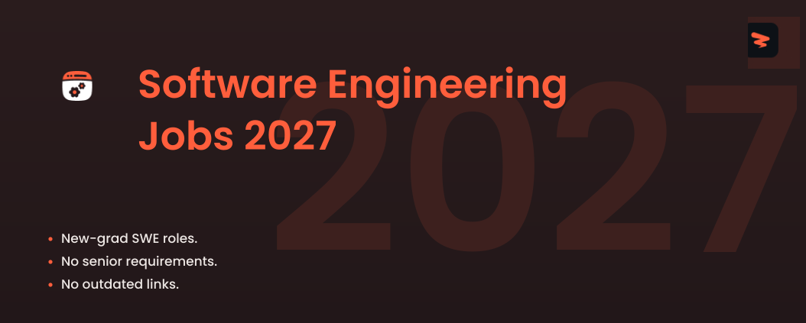

<!-- Cover -->

# Software Engineering Jobs 2027

🚀 Software engineering jobs for new graduates, updated every 10 minutes.

  
  
  
  

---

## **Website & Autofill Extension**

Explore Zapply's website and check out:

- Our Chrome extension, which autofills job applications in seconds.
- A dedicated job board featuring the latest openings across various roles.
- User accounts with multiple profiles for different resume types and roles.
- Job application tracking with streaks and commitment awards.

Experience an advanced career journey with us! 🚀

  

## Explore Around

Connect and seek advice from a growing network of fellow students and new grads.

  
  &nbsp;&nbsp;
  

---

 

<h3>💻 <strong>Software Engineering</strong></h3>

| Company | Role | Location | Posted | Visa | **Apply** |
|---------|------|----------|--------|------|----------|
| **FIS** | Mainframe Software Engineer I | GA CMH ONE RIVERFRONT | 15m | ✅ Sponsor |  |
| **Thomson Reuters** | Software Engineer Co-Op | Rochester New York | 24m | ✅ Sponsor |  |
| **T-Mobile** | Summer 2027 T-Ads Software Engineering Internship | Philadelphia, Pennsylvania | 35m | ✅ Sponsor |  |
| **T-Mobile** | Summer 2027 T-Ads Software Engineering Internship | Philadelphia, Pennsylvania | 35m | ✅ Sponsor |  |
| **RTX** | Embedded Software Developer I  (Onsite) | CA-EL SEGUNDO-R01 | 1h | ✅ Sponsor |  |
| **Veolia Environnement SA** | Manufacturing Software Engineer Intern | Boulder, CO | 1h | ✅ Sponsor |  |
| **Cursor** | Software Engineer, New Grad 2027 | San Francisco, CA | 15h |  |  |
| **Schweitzer Engineering Laboratories** | Application Engineering Intern | Mississippi Jackson | Date unknown | ✅ Sponsor |  |
| **Pivotal Software** | Internship, Software Engineering (Summer 2027) | Palo Alto, CA | 17h |  |  |
| **Rocket Lab** | Software Engineer I | Pasadena, CA | 17h |  |  |
| **Boston Scientific** | Urology R&D Software Engineering Co-op | United States  US-MN-Maple Grove | 19h |  |  |
| **WHOOP** | Software Engineer I (Backend, Growth) | Boston, MA | 19h | ✅ Sponsor |  |
| **Lila Sciences** | Co-op, Software, Applied AI Platform Engineer | San Francisco, CA USA | 21h | ✅ Sponsor |  |
| **UiPath** | Software Engineer Intern | Bellevue | 23h | ✅ Sponsor |  |
| **NBCUniversal** | Software Engineering Internships – Summer 2027 | New York, NY | 1d | ✅ Sponsor |  |
| **NBCUniversal** | Software Engineering Internships – Summer 2027 | Universal City, CA | 1d | ✅ Sponsor |  |
| **Aerospace Corporation** | Junior Full Stack Engineer | Chantilly, VA | 1d |  |  |
| **Aerospace Corporation** | Software Engineering Section Manager | El Segundo, CA | 1d |  |  |
| **Warner Bros. Discovery** | WB Games Software Engineering Co-op: Needham, MA - January-May 2027 | MA Needham 117 Kendrick St | 1d | ✅ Sponsor |  |
| **Trimble** | Software Engineer Intern | OR, Lake Oswego | 1d | ✅ Sponsor |  |
| **RTX** | Embedded Security Software Engineer I (Onsite) | CA-EL SEGUNDO-R01 | 1d | ✅ Sponsor |  |
| **RTX** | Embedded Security Software Engineer I (Onsite) | AZ-TUCSON | 1d | ✅ Sponsor |  |
| **GE Vernova** | GE Vernova - Energy Optimization Software Engineer Intern - Summer 2027 | Bellevue | 1d | ✅ Sponsor |  |
| **Radiance Technologies** | Software Engineer Intern Spring/Summer 2027 | Dayton | 1d |  |  |
| **Radiance Technologies** | Software Engineer Intern Spring/Summer 2027 | Dayton | 1d |  |  |
| **Cisco** | Software Engineer Full-Stack / Backend I (Intern) – United States | San Jose California US | 1d | ✅ Sponsor |  |
| **Cisco** | Software Engineer Full-Stack / Backend I (Intern) – United States | San Jose, California | 1d | ✅ Sponsor |  |
| **BAE Systems** | Embedded Software Engineer Spring/Summer 2027 | Maple Grove, Minnesota | 1d |  |  |
| **GE Aerospace** | Engines Engineering Intern – Computer or Software Engineering – US – Summer 2027 | Evendale | 3d | ✅ Sponsor |  |
| **AbbVie** | Associate Software Engineer I | North Chicago, IL | 3d | ✅ Sponsor |  |
| **Astranis** | Embedded Software Developer, Network/Payload Intern (Winter 2027) | San Francisco | 3d |  |  |
| **The New York Times** | Backend Engineering Intern | New York, NY | 3d | ✅ Sponsor |  |
| **The New York Times** | Android Engineering Intern | New York, NY | 3d | ✅ Sponsor |  |
| **The New York Times** | Frontend Engineering Intern | New York, NY | 3d | ✅ Sponsor |  |
| **Notion** | Software Engineering Intern, Frontend (Summer 2027) | New York, New York | 3d | ✅ Sponsor |  |
| **Notion** | Software Engineering Intern, iOS (Summer 2027) | New York, New York | 3d | ✅ Sponsor |  |
| **Samsara** | Software Engineering Internship - San Francisco | San Francisco - SF9 | 3d | ✅ Sponsor |  |
| **Rocket Companies** | Software Engineer I | Detroit, MI | 4d | ✅ Sponsor |  |
| **General Motors** | 2027 Summer Intern – Software Engineer, AV/AI Platform | 2 Locations | 4d | ✅ Sponsor |  |
| **Boeing** | Systems Software Engineer, Missile Defense National Team (Associate, Experienced, Senior) | Colorado Springs, CO | 4d | ✅ Sponsor |  |
| **Boeing** | Software Engineer (Associate, Experienced or Lead) | USA - El Segundo, CA | 4d | ✅ Sponsor |  |
| **ASM** | Software Engineer - Early Career | > Arizona > Phoenix | 4d |  |  |
| **CACI** | Junior C# Software Engineer | Virginia Beach VA US | 4d | ✅ Sponsor |  |
| **CACI** | Software Engineering Co-op - Spring 2027 | King of Prussia, PA, US | 4d | ✅ Sponsor |  |
| **Cisco** | Software Engineer Embedded Systems I (Full Time) - United States | San Jose California US | 4d | ✅ Sponsor |  |
| **Waymo** | 2027 Summer Intern, BS/MS, Software Engineer, Multiverse | San Francisco, California, USA | 4d | ✅ Sponsor |  |
| **Nightwing** | Software Developer I (System Security) | Huntsville, AL | 4d |  |  |
| **Hitachi** | Full Stack Developer Intern | Dallas, Texas, United States | 4d | ✅ Sponsor |  |
| **T-Mobile** | Summer 2027 Software Engineering Internship | Overland Park, Kansas | 4d | ✅ Sponsor |  |
| **Fresenius Medical Care** | Software Engineering Co-op | Lawrence, MA, USA | 4d | ✅ Sponsor |  |
| **Match Group** | Backend Engineer Intern | Palo Alto, California | 4d |  |  |
| **Match Group** | Android Engineer Intern | Los Angeles, California | 4d |  |  |
| **Match Group** | iOS Engineer Intern | Los Angeles, California | 4d |  |  |
| **GM Financial** | Intern - Software Development Engineer | Arlington, TX, United States | 4d |  |  |
| **MITRE** | Internships in Computer Science or Software Engineering | McLean, Virginia | 4d |  |  |
| **Apex Technology** | Ground Software Engineering Internship (Spring or Summer 2027) | Los Angeles | 4d |  |  |
| **Apex Technology** | Software Engineering Internship, Test & Automation (Summer 2027) | Los Angeles | 4d |  |  |
| **Palantir** | Software Engineer, Internship - Sovereign AI Systems | New York, NY | 4d | ✅ Sponsor |  |
| **Apex Technology** | Software Engineering Internship, Embedded Systems (Spring or Summer 2027) | Los Angeles | 4d |  |  |
| **StubHub** | Software Engineer I (New Grad) - Consumer Experience | New York, New York, United States | 4d | ✅ Sponsor |  |
| **Shield AI** | June 2027 Co-Op - Software Engineer Intern | Dallas, Texas | 4d | ✅ Sponsor |  |
| **Microsoft** | Software Engineer: Security & Identity Intern Opportunities for University Students, Redmond | Redmond, Washington, United States | 4d | ✅ Sponsor |  |
| **JM Family Enterprises** | Software Engineer Intern | Florida - Deerfield Beach | 5d |  |  |
| **F5** | Mgr, Software Development Engineering | Seattle | 5d | ✅ Sponsor |  |
| **CACI** | Junior Software Developer | Remote | 5d | ✅ Sponsor |  |
| **Booz Allen Hamilton** | University - 2027 Summer Games Software Developer Intern - Dayton, OH | Dayton, OH | 5d | ✅ Sponsor |  |
| **Northrop Grumman** | 2027 Spring Co-op Software Engineer Intern – McClellan CA | United States-California-McClellan | 5d |  |  |
| **Leidos** | Software Engineering & AI Intern | 6314 RemoteTeleworker US | 5d | ✅ Sponsor |  |
| **Microsoft** | Research Intern - Research in Software Engineering, ML Systems, Agents | Redmond, Washington, United States | 5d | ✅ Sponsor |  |
| **Amazon.com Services LLC** | Software Development Engineer Intern - Summer 2027 | Seattle, WA | 5d | ✅ Sponsor |  |
| **Amazon.com Services LLC** | Software Development Engineer (Embedded systems), Amazon Leo, Early Career - 2027 (US) | Redmond, WA | 5d | ✅ Sponsor |  |
| **Amazon.com Services LLC** | Software Development Engineer, Amazon Leo, Early Career - 2027 (US) | Redmond, WA | 5d | ✅ Sponsor |  |
| **Northrop Grumman** | 2027 Software Engineering Intern - Roy UT | United States-Utah-Roy | 5d |  |  |
| **Northrop Grumman** | 2027 DevOps Software Engineering Intern - Roy UT | United States-Utah-Roy | 5d |  |  |
| **Figma** | PhD Intern, Software Engineer - Interaction Design (2027) | San Francisco, CA • New York, NY | 5d | ✅ Sponsor |  |
| **Parsons** | Software Engineering Intern (Summer 2027) | AL, Huntsville, R187299 | Date unknown |  |  |
| **Boeing** | Embedded Software Engineer (Associate, Experienced, or Senior) | USA - El Segundo, CA | 6d | ✅ Sponsor |  |
| **Adobe** | Mgr, Software Development | New York | 6d | ✅ Sponsor |  |
| **AeroVironment** | Software Engineering Intern | Melbourne, FL | 6d |  |  |
| **Salesforce** | Software Engineering, AI Systems (PMTS) | California San Francisco | 6d | ✅ Sponsor |  |
| **Caterpillar** | Oil and Gas Project Application Engineering Intern | San Diego, California | 6d | ✅ Sponsor |  |
| **Apple** | Software Engineering Systems | Cupertino | 6d | ✅ Sponsor |  |
| **AMD** | Software Development Eng. | San Jose, CA, United States | 6d | ✅ Sponsor |  |
| **ByteDance** | Video/Image AI/ML Software Engineer - Graduate (Video and Edge, Multimedia Lab) - 2027 Start (PhD) | San Jose, California | Date unknown | ✅ Sponsor |  |
| **Microsoft** | Software Engineer, Teamwork Experiences Internship Opportunities | Redmond, Washington, United States | 6d | ✅ Sponsor |  |
| **Salesforce** | Software Engineering, AI Systems (SMTS) | California San Francisco | 6d | ✅ Sponsor |  |
| **Rocket Companies** | Software Engineer I | Detroit, MI | 1w | ✅ Sponsor |  |
| **LexisNexis Risk Solutions** | Tech Accelerate Graduate Program - Software Engineer I | Alpharetta, GA | 1w | ✅ Sponsor |  |
| **RELX** | Tech Accelerate Graduate Program - Software Engineer I | Alpharetta, GA | 1w | ✅ Sponsor |  |
| **HP Inc** | Software Engineering Intern, AIML Platform - HP IQ | San Francisco, California,... | 1w | ✅ Sponsor |  |
| **HP Inc** | Software Engineering Intern, Product & Developer Productivity - HP IQ | San Francisco, California,... | 1w | ✅ Sponsor |  |
| **Trimble** | Software Engineering Intern | CO Westminster | 1w | ✅ Sponsor |  |
| **Cox** | Software Engineering Intern - Summer 2027 (Austin, TX) | Austin TX | 1w | ✅ Sponsor |  |
| **Arrowstreet Capital** | Software Engineer Intern, Summer 2027 | Boston | 1w |  |  |
| **Parsons** | Software Engineer I - Top Secret | Remote (Any Location), R188151 | Date unknown |  |  |
| **Booz Allen Hamilton** | University - 2027 Summer Games Software Developer Intern - Albuquerque, NM | Albuquerque, NM | 1w | ✅ Sponsor |  |
| **Booz Allen Hamilton** | Software Engineer, Junior | Albuquerque, NM | 1w | ✅ Sponsor |  |
| **Leidos** | Junior Software Engineer (SWE-1) | 3325 Fort George G. Meade MD | 1w | ✅ Sponsor |  |
| **Leidos** | Junior Software Engineer | Tucson, AZ | 1w | ✅ Sponsor |  |
| **Dell Technologies** | CSG Software Engineering Undergraduate Intern | TX, United States | 1w |  |  |

Apply for more jobs at

<h3>🤖 <strong>AI / ML Engineering</strong></h3>

| Company | Role | Location | Posted | Visa | **Apply** |
|---------|------|----------|--------|------|----------|
| **CACI** | Data Engineering/Analytics Support | Norco, CA, US | 3d | ✅ Sponsor |  |
| **The Travelers Companies** | Data Engineer I (AWS, Python, GenAI) | CT Hartford | 4d |  |  |
| **General Motors** | R&D Researcher – AI and Machine Learning | Warren, Michigan, United States... | 4d | ✅ Sponsor |  |
| **NVIDIA** | Research Scientist, AI and Systems Security - PhD New College Grad 2026 | MA Westford | 4d | ✅ Sponsor |  |
| **NVIDIA** | PhD Research Scientist, Fundamental Generative AI - New College Grad 2026 | US, CA, Santa Clara | 4d | ✅ Sponsor |  |
| **Thales** | AI Engineer - Graduate | Orlando | 4d |  |  |
| **T-Mobile** | Summer 2027 Data Engineering Internship | Frisco Texas | 4d | ✅ Sponsor |  |
| **T-Mobile** | Summer 2027 Data Engineering Internship | Frisco Texas | 4d | ✅ Sponsor |  |
| **T-Mobile** | Summer 2027 AI Engineering Internship | Bellevue, Washington | 4d | ✅ Sponsor |  |
| **ICD** | Summer 2027 AI/ML Engineering Internship | Jersey City, NJ, United States | 4d |  |  |
| **Tradeweb** | Summer 2027 AI/ML Engineering Internship | Jersey City, NJ, United States | 4d |  |  |
| **JM Family Enterprises** | Data Engineering Intern | Florida - Deerfield Beach | 5d |  |  |
| **University of Texas at Austin** | Research Engineering/ Scientist Associate I | AUSTIN, TX | 5d |  |  |
| **University of Texas at Austin** | Research Engineering/ Scientist Associate I | AUSTIN, TX | 5d |  |  |
| **The Travelers Companies** | Data Engineer I (Databricks, AWS, Python) | CT Hartford | 6d |  |  |
| **Bose** | DSP/ML Research Engineer Intern   Summer 2027 | US, MA - Framingham | 6d | ✅ Sponsor |  |
| **Bose** | DSP/ML Research Engineer Co-op   Spring 2027 | US, MA - Framingham | 6d | ✅ Sponsor |  |
| **Parsons** | AI/ML Engineering Intern Summer 2027 | VA, Centreville, R188194 | Date unknown |  |  |
| **Etched** | IA Research Engineer Intern | San Jose | 6d | ✅ Sponsor |  |
| **Bose** | Software/DSP Research Engineer Co-op | US, MA - Framingham | 1w | ✅ Sponsor |  |
| **Apple** | Computational Support for Machine Learning and Transformers, Core OS | Cupertino | 1w | ✅ Sponsor |  |
| **Clarity Innovations** | Junior Reverse Engineering/Vulnerability Research Engineer | Columbus, OH | 1w |  |  |
| **Gilead Sciences** | Research Scientist I, Attribute Sciences Computational Biology, AI & Scientific Informatics | United States - California -... | 1w | ✅ Sponsor |  |
| **Booz Allen Hamilton** | University - 2027 Summer Games Data Scientist Intern - Royal Oak, MI | Detroit, MI | 1w | ✅ Sponsor |  |
| **Booz Allen Hamilton** | Data Scientist, Junior | Washington, DC | 1w | ✅ Sponsor |  |
| **NVIDIA** | Research Scientist, Autonomous Systems and Physical AI Research - PhD New College Grad 2026 | US, CA, Santa Clara | 1w | ✅ Sponsor |  |
| **MITRE** | Data Science and Engineering Intern | McLean, Virginia | 1w |  |  |
| **Booz Allen Hamilton** | University - 2027 Summer Games Data Scientist Intern - McLean, VA | McLean, VA | 1w | ✅ Sponsor |  |
| **Mercor** | Research Engineer, Intern – Benchmarking | San Francisco | 1w |  |  |
| **Mercor** | Research Engineer Intern - Environments, Data and Post-Training | San Francisco | 1w |  |  |
| **National Interstate Insurance** | Data Engineering Intern – Summer 2027 | Cincinnati, OH | 2w |  |  |
| **Sony** | Research Engineer Intern (Ethical Creative and Protective AI Lab) | New York | 2w |  |  |
| **Micron Technology** | Intern -  AI Engineer Platform | Boise, ID - Main Site | 2w | ✅ Sponsor |  |
| **Saviynt** | Research Scientist Intern - PhD | Milpitas, California | 2w | ✅ Sponsor |  |
| **ByteDance** | Data Lake Infrastructure & Data Analytics Research Engineer Intern (AML-Ark-US) - 2027 Summer | Seattle, Washington | Date unknown | ✅ Sponsor |  |
| **ByteDance** | Data Lake Infrastructure & Data Analytics Research Engineer Intern (AML-Ark-US) - 2027 Summer | San Jose, California | Date unknown | ✅ Sponsor |  |
| **Rivian and Volkswagen Group Technologies** | Data Engineering Intern - AI & Analytics (Summer 2027) | Palo Alto, California | 2w | ✅ Sponsor |  |
| **MITRE** | AI Engineering Intern | Bedford, Massachusetts | 2w |  |  |
| **AeroVironment** | Machine Learning Engineering Intern | Centreville, VA | 3w |  |  |
| **Anduril** | Winter 2027 Research Engineer Co-op | Santa Ana, California, United... | 3w |  |  |
| **Duolingo** | AI Research Engineer, New PhD Graduate | New York, NY | 4w | ✅ Sponsor |  |
| **Nissan** | Financial AI Engineering Intern - Summer 2027 - Franklin, TN | Franklin, Tennessee - United... | 4w |  |  |
| **Crowe** | Machine Learning Intern | Chicago, IL | 1mo |  |  |
| **Intel** | System Technology Research Engineer - (PhD Intern) | Oregon Hillsboro | 1mo | ✅ Sponsor |  |
| **Intel** | Software Research Engineering - (PhD Intern) | US, Oregon, Hillsboro | 1mo | ✅ Sponsor |  |
| **Campbell Soup Company** | Data Engineer – Agentic AI & ML Ops (Co-op) | USA - NJ - Camden | 1mo |  |  |
| **Marmon Holdings** | Data Engineering Intern OR Student Co-Op | Milwaukee, WI | 1mo |  |  |
| **Capital One** | Current PhD, AI Engineering Internship Program - Summer 2027 | New York, NY | 1mo | ✅ Sponsor |  |
| **Capital One** | Current Master's, AI Engineering Internship Program - Summer 2027 | New York, NY | 1mo | ✅ Sponsor |  |
| **AspenTech** | Data Science Intern - Summer 2027 - Bedford, MA | Bedford, Massachusetts | 1mo | ✅ Sponsor |  |
| **Moderna** | Co-Op, Research Engineering and AI Integration | Cambridge, Massachusetts, Research | 1mo |  |  |
| **Plexus** | Intern - IT Data Science (Summer 2027) | Neenah, WI | 1mo |  |  |
| **IMC Trading** | Machine Learning Engineer Intern - Summer 2027 | New York, United States | 1mo | ✅ Sponsor |  |
| **First Solar** | Data Engineering Intern (Spring 2027) | Perrysburg, OH, United States | 1mo | ✅ Sponsor |  |
| **IMC Trading** | Hardware Machine Learning PhD Research Internship | Chicago, United States | 1mo | ✅ Sponsor |  |
| **Together AI** | Systems Research Engineer Intern - GPU Programming (Summer 2027) | San Francisco | 1mo | ✅ Sponsor |  |
| **Qualcomm** | Machine Learning & Artificial Intelligence Engineering Internship – Summer 2027 | San Diego, CA | 1mo | ✅ Sponsor |  |
| **Gecko Robotics** | AI/Machine Learning Engineering Intern | New York City | 1mo | ✅ Sponsor |  |
| **DV Trading** | AI Engineer Intern - Summer 2027 | Chicago | 2026-09-09 |  |  |
| **Rivian and Volkswagen Group Technologies** | Data Engineering Intern - AI & Analytics (January - August 2027) | Palo Alto, California | 2026-09-08 | ✅ Sponsor |  |
| **Solidigm** | 2027 Graduate Software, Firmware & AI Engineering Internships - US | Rancho Cordova, CA | 2026-09-05 |  |  |
| **The Nuclear Company** | Summer 2027 Data Science Intern | Washington, DC | 2026-08-07 |  |  |
| **The Nuclear Company** | Summer 2027 AI/ML Engineering Intern | Washington, DC | 2026-08-07 |  |  |
| **The Nuclear Company** | Spring 2027 Data Science Intern | Washington, DC | 2026-08-07 |  |  |
| **Yotta Labs** | Research Engineer Intern - AI Systems | United States | 2026-08-02 | ✅ Sponsor |  |
| **Jump Trading** | Campus AI Research Engineer – Research Automation (Intern) | Chicago | 2026-07-08 | ✅ Sponsor |  |
| **Jump Trading** | Campus AI Research Engineer - Deep Learning (Intern) | Chicago | 2026-07-08 | ✅ Sponsor |  |
| **Jump Trading** | Campus AI Research Engineer (Intern) | Chicago | 2026-07-08 | ✅ Sponsor |  |
| **Perpay** | Data Engineering Internship, Summer 2027 | Philadelphia, Pennsylvania,... | 2023-09-12 | ✅ Sponsor |  |

Apply for more jobs at

<h3>🔒 <strong>Infrastructure & Security</strong></h3>

| Company | Role | Location | Posted | Visa | **Apply** |
|---------|------|----------|--------|------|----------|
| **T-Mobile** | Summer 2027 Site Reliability Engineering Internship | Frisco Texas | 35m | ✅ Sponsor |  |
| **Illumio** | Engineering Intern, SRE | Sunnyvale, California - | 17h | ✅ Sponsor |  |
| **Lila Sciences** | Co-Op, IT/OT Security Analyst | Cambridge, MA USA | 21h | ✅ Sponsor |  |
| **NBCUniversal** | Media Tech: Cybersecurity, Governance & Security Engineering Internships – Summer 2027 | New York, NY | 1d | ✅ Sponsor |  |
| **Zoetis** | Information Security Intern | Parsippany | 1d | ✅ Sponsor |  |
| **HP Inc** | Cloud Engineering Intern - HP IQ | San Francisco, California,... | 1d | ✅ Sponsor |  |
| **Johnson & Johnson** | Software Test Engineering Co-op (RLM) | Danvers, Massachusetts, United... | 1d | ✅ Sponsor |  |
| **Apple** | Tools & Automation Engineer — Early Career | Sunnyvale | 1d | ✅ Sponsor |  |
| **CACI** | Cyber Security Intern - Summer 2027 | Sterling, VA, US | 1d | ✅ Sponsor |  |
| **RTX** | Battlespace Cybersecurity Researcher | IA-CEDAR RAPIDS | 1d | ✅ Sponsor |  |
| **Boston Scientific** | Software & Systems Testing Engineering Intern | Arden Hills US-MN, United... | 1d |  |  |
| **Northrop Grumman** | 2027 Software Testing Engineering Intern - Apopka FL | United States-Florida-Apopka | 1d |  |  |
| **Yahoo** | Paranoids Technical Security Engineer I | United States of America | 1d | ✅ Sponsor |  |
| **Varda Space** | Site Reliability Internship - Summer 2027 | El Segundo, California, United... | 3d |  |  |
| **Vanguard** | Cloud Security Penetration Tester | DallasFt Worth, TX | 4d | ✅ Sponsor |  |
| **John Deere** | Part-Time Student - Test Automation Engineering - Silvis, IL | Silvis, IL,Illinois,United States | 4d |  |  |
| **Booz Allen Hamilton** | Information Security Risk Specialist | Patuxent River, MD | 4d | ✅ Sponsor |  |
| **JLL** | Automation Engineering Apprentice | Niagara Falls, NY | 4d | ✅ Sponsor |  |
| **Etched** | Infrastructure Engineering & Projects Intern | San Jose | 4d | ✅ Sponsor |  |
| **Boeing** | DevOps Developer (Associate or Experienced or Lead) | Seal Beach, CA | 5d | ✅ Sponsor |  |
| **ASML** | Internship - Application Software QA Engineer | San Jose, CA, USA | 5d | ✅ Sponsor |  |
| **GDIT** | Penetration Tester - TS/SCI with Polygraph | USA VA McLean | 5d | ✅ Sponsor |  |
| **Mastercard** | Site Reliability Engineer I | O'Fallon, Missouri | 5d | ✅ Sponsor |  |
| **Mastercard** | Site Reliability Engineer I | O'Fallon, Missouri | 5d | ✅ Sponsor |  |
| **Federal Reserve System** | 2027 Summer Internship Program - Information Security Intern | Atlanta, GA | 5d |  |  |
| **RTX** | Infrastructure Engineer I (Onsite) | UT-WEST VALLEY CITY | 5d | ✅ Sponsor |  |
| **Northrop Grumman** | 2027 Software Test Engineering Intern - Roy UT | United States-Utah-Roy | 5d |  |  |
| **CACI** | Cloud/DevOps Exploitation Specialist | Remote | 6d | ✅ Sponsor |  |
| **LLNL** | Cybersecurity Undergraduate Intern - Cyber and Critical Infrastructure Summer Institute - Summer... | Livermore, CA | 6d | ✅ Sponsor |  |
| **LLNL** | Cybersecurity Graduate Intern - Cyber and Critical Infrastructure Summer Institute - Summer 2027 | Livermore, CA | 6d | ✅ Sponsor |  |
| **GM Financial** | Intern - Cloud Engineer | Irving, TX, United States | 6d |  |  |
| **RTX** | Systems Security Engineering Intern (Summer 2027) | CA-FULLERTON | 1w | ✅ Sponsor |  |
| **ICD** | Summer 2027 Cyber Security Internship | New York, NY, United States | 1w |  |  |
| **Tradeweb** | Summer 2027 Cyber Security Internship | New York, NY, United States | 1w |  |  |
| **Sierra Nevada Corporation** | DevOps Engineer Intern (Summer 2027) | Southern Pines, NC | 1w |  |  |
| **LSEG** | DevOps & Application Services Manager | St. Louis, Missouri | 1w |  |  |
| **Plexus** | Intern - Automation Engineer (Summer 2027) | Nampa, ID | 1w |  |  |
| **Federal Reserve System** | 2027 Summer Internship Program - Supervision & Regulation (Cybersecurity) | Atlanta, GA | 1w |  |  |
| **GDIT** | Network Security Engineer Junior | USA VA Ashburn | 1w | ✅ Sponsor |  |
| **GDIT** | Penetration Tester Junior | USA VA Ashburn | 1w | ✅ Sponsor |  |
| **Fortinet** | Software Dev QA Engineer (Early Career/NPI) | Sunnyvale, CA, United States | 1w | ✅ Sponsor |  |
| **GardaWorld** | Infrastructure Engineer Intern | Wayzata, Minnesota, United States | 1w |  |  |
| **Schweitzer Engineering Laboratories** | Automation Engineering Intern | Idaho - Moscow | Date unknown | ✅ Sponsor |  |
| **Boeing** | Product Security Analyst (Mid-Level or Experienced) | Aurora, CO | 1w | ✅ Sponsor |  |
| **Northrop Grumman** | 2027 Software Test Engineering Intern- Roy UT | United States-Utah-Roy | 1w |  |  |
| **National Interstate Insurance** | DevOps Developer Intern - Summer 2027 | Cincinnati, OH | 1w |  |  |
| **Cisco** | Software QA Engineer I (Full Time) - United States | Richardson, Texas, US | 1w | ✅ Sponsor |  |
| **Booz Allen Hamilton** | University - 2027 Summer Games Cyber Security Intern - Lexington, MA | Lexington, MA | 1w | ✅ Sponsor |  |
| **Booz Allen Hamilton** | Information Security Risk Specialist | St Inigoes, MD | 1w | ✅ Sponsor |  |
| **Figma** | PhD Intern, Security Engineer (2027) | San Francisco, CA • New York, NY | 1w | ✅ Sponsor |  |
| **Cisco** | Software QA Engineer I (Full Time) - United States | Richardson, Texas | 1w | ✅ Sponsor |  |
| **The Nuclear Company** | Spring 2027 Security Engineer Intern | Washington, DC | 1w |  |  |
| **HP Inc** | Software Product Security Intern - HP IQ | San Francisco, California,... | 1w | ✅ Sponsor |  |
| **HP Inc** | Software Quality Assurance Intern | San Francisco, California,... | 1w | ✅ Sponsor |  |
| **AspenTech** | DevOps Engineer I | Bedford, Massachusetts | 1w | ✅ Sponsor |  |
| **Leidos** | Cybersecurity Engineer Co-op | Bethesda, MD | 1w | ✅ Sponsor |  |
| **Visa** | Network and Security Engineering Intern - 2027, Highlands Ranch, CO | Denver, CO | 1w | ✅ Sponsor |  |
| **Esri** | DevOps Engineer I – Azure | Redlands, CA | 2w | ✅ Sponsor |  |
| **Visa** | Network and Security Engineering Intern - 2027, Ashburn, VA | Ashburn, VA | 2w | ✅ Sponsor |  |
| **ABB** | Automation Engineer Intern - Summer 2027 | New Berlin, Wisconsin, United... | 2w | ✅ Sponsor |  |
| **ABB** | Automation Engineer Intern - Summer 2027 | New Berlin, Wisconsin, United... | 2w | ✅ Sponsor |  |
| **Jabil** | Automation Engineering Intern | Clinton, MA | 2w | ✅ Sponsor |  |
| **Leidos** | Cybersecurity Intern | Arlington, VA | 2w | ✅ Sponsor |  |
| **Wells Fargo** | 2027 Technology Summer Internship - Early Careers (Cybersecurity) | CHARLOTTE, NC | 2w | ✅ Sponsor |  |
| **Boston Properties** | Cyber Security Co-Op | Boston, MA, United States | 2w |  |  |
| **AbbVie** | 2027 Business Technology Solutions Intern - Cybersecurity (Undergraduate) | North Chicago, IL | 2w | ✅ Sponsor |  |
| **Cox** | Cybersecurity Intern - Summer 2027 | Atlanta GA | 2w | ✅ Sponsor |  |
| **Analog Devices** | DevOps Co-Op | US, MA, Boston | 2w | ✅ Sponsor |  |
| **Impulse Space** | Information Security Intern (Summer 2027) | Redondo Beach, California | Date unknown |  |  |
| **ByteDance** | Site Reliability Engineer Intern (Data Infra) - 2027 Summer | Seattle, Washington | Date unknown | ✅ Sponsor |  |
| **ByteDance** | Production System Engineer Project Intern (Server DevOps) - 2027 Start | San Jose, California | Date unknown | ✅ Sponsor |  |
| **ByteDance** | Production System Engineer Project Intern (Server DevOps) - 2027 Start | New York, New York | Date unknown | ✅ Sponsor |  |
| **ASML** | Internship - Software Quality Assurance | San Jose, CA, USA | 2w | ✅ Sponsor |  |
| **ASML** | Internship - Software Quality Assurance | San Jose, CA, USA | 2w | ✅ Sponsor |  |
| **HPE (University)** | Cybersecurity Engineering Intern | Spring, Texas, United States of... | 2w | ✅ Sponsor |  |
| **Copart** | SDET Intern | Dallas, TX - Headquarters | 2w | ✅ Sponsor |  |
| **Nissan** | Cyber Security Intern - Summer 2027 - Smyrna, TN | Smyrna, Tennessee - United... | 2w |  |  |
| **Aerospace Corporation** | 2027 Hardware Security Engineering Undergrad  Intern | El Segundo, CA | 2w |  |  |
| **Aerospace Corporation** | 2027 Hardware Security Engineering Grad Intern | El Segundo, CA | 2w |  |  |
| **Intel** | Information Security Engineer Undergraduate Intern | US, California, Folsom | 2w | ✅ Sponsor |  |
| **Illumio** | Engineering Intern, Product Security | Sunnyvale, California - | 2w | ✅ Sponsor |  |
| **Geotab** | Site Reliability Engineering | Remote - US | 2w | ✅ Sponsor |  |
| **Adobe** | 2027 Intern - Security Engineer | San Jose | 3w | ✅ Sponsor |  |
| **Johnson & Johnson** | Software Test Engineering Co-op (Beatbox) | Danvers, Massachusetts, United... | 3w | ✅ Sponsor |  |
| **Adobe** | 2027 Intern - Security Engineer | Lehi | 3w | ✅ Sponsor |  |
| **ICF** | 2027 Summer Intern, Cloud Engineer (AWS/Azure) (Reston, VA) | Reston, VA | 3w |  |  |
| **Leidos** | Cloud Engineering Intern | 6314 Remote/Teleworker US | 3w | ✅ Sponsor |  |
| **General Matter** | Summer 2027 Internship - Information Security Engineer | Los Angeles, CA | 3w |  |  |
| **NREL** | Graduate (10-12 weeks) Intern - AI/ML for Cybersecurity | Golden, CO | 3w | ✅ Sponsor |  |
| **CACI** | Software Test Engineer Intern - Spring 2027 | Remote | 3w | ✅ Sponsor |  |
| **Emerson Electric** | Controls & Automation Engineering Co‑Op –  Latham, NY - Summer 2027 | Latham, NY, United States | 3w | ✅ Sponsor |  |
| **Blue Origin** | Summer 2027 Test Engineering Internship - Graduate | Van Horn, TX | 4w |  |  |
| **Blue Origin** | Summer 2027 Test Engineering Internship - Undergraduate | Greater Seattle Area | 4w |  |  |
| **Bosch Group** | Information Security and Privacy Intern | Farmington Hills, MI | 4w | ✅ Sponsor |  |
| **Tencent** | Site Reliability Engineer (SRE) Intern — AI Infrastructure | California-Palo Alto | 1mo | ✅ Sponsor |  |
| **Tencent** | Cyber Security Engineer Intern | California-Palo Alto | 1mo | ✅ Sponsor |  |
| **Pentair** | IT & Cybersecurity Leadership Development Internship Program -  Summer 2027 | Golden Valley, MN | 1mo |  |  |
| **Crowe** | Cybersecurity Intern | Chicago, IL | 1mo |  |  |
| **Expedia Group** | Security Engineering Intern - 2027 - Seattle | Washington - Seattle | 1mo | ✅ Sponsor |  |
| **Vanguard** | College to Corporate IT Internship-Risk & Security Engineer (PA) | Malvern, PA | 1mo | ✅ Sponsor |  |

Apply for more jobs at

<h3>⚙️ <strong>Systems & Embedded</strong></h3>

| Company | Role | Location | Posted | Visa | **Apply** |
|---------|------|----------|--------|------|----------|
| **Polaris** | Engineering Process Owner – Systems Engineering | Wyoming, MN, USA | 15m |  |  |
| **Boeing** | Design-for-Test (DFT) Engineer — ASIC Backend – (Associate, Experienced, or Lead) | El Segundo, CA | 16m | ✅ Sponsor |  |
| **Fresenius Medical Care** | V&V Systems Engineer Co-op | Lawrence, MA, USA | 10h | ✅ Sponsor |  |
| **Intuitive** | Robotics and Controls Engineering Intern | Sunnyvale, CA | 16h | ✅ Sponsor |  |
| **Persona AI** | Humanoid Robotics Software Internship | Pensacola, FL or Houston, TX | 19h |  |  |
| **Skydio** | Systems Engineering Intern - Summer 2027 | San Mateo, California, United... | 20h | ✅ Sponsor |  |
| **CACI** | Junior Systems Engineer | Colorado Springs, CO, US | 1d | ✅ Sponsor |  |
| **ABB** | Systems Engineering Intern - Summer 2027 | USA, OH, Cleveland | 1d | ✅ Sponsor |  |
| **UPS** | Buildings and Systems Engineering Supervisor (BaSE) | NASHVILLE, Tennessee | 1d | ✅ Sponsor |  |
| **Cummins** | Systems Engineering Product Specialist | Seattle, WA, United States | 1d | ✅ Sponsor |  |
| **Cummins** | Systems Engineering Product Specialist | Seattle, WA, United States | 1d | ✅ Sponsor |  |
| **UPS** | Building and Systems Engineering Specialist | NEW ORLEANS, Louisiana | 2d |  |  |
| **UPS** | Maintenance Mechanic- Building & Systems Engineering (BaSE) | MEMPHIS, Tennessee | 3d |  |  |
| **Booz Allen Hamilton** | C4I Systems Engineer | North Charleston, SC | 3d | ✅ Sponsor |  |
| **General Motors** | Entry Level Mainframe Systems Engineer | Warren, Michigan, United States... | 4d | ✅ Sponsor |  |
| **Carrier Global** | Systems Engineering Intern - Summer | CAG01: CTD-Athens, 700 Olympic... | 4d |  |  |
| **Draper** | GNC Systems Engineering Co-Op (Spring 2027) | Cambridge, MA | 4d |  |  |
| **Draper** | GNC Systems Engineering Intern (Summer 2027) | Cambridge, MA | 4d |  |  |
| **Draper** | Systems Engineering Co-Op (Spring 2027) | Cambridge, MA | 4d |  |  |
| **Moog** | Intern, Systems Engineering | Buffalo, NY | 4d |  |  |
| **CACI** | Junior Boundary Systems Engineer | Linthicum MD US | 4d | ✅ Sponsor |  |
| **Wash U** | Systems Engineer I (Time Limited/Remote) - WUIT, Cloud Security | Washington University Medical | 4d |  |  |
| **Salesforce** | Systems Engineering Associate, Early Talent | Texas - Dallas | 5d | ✅ Sponsor |  |
| **Booz Allen Hamilton** | University - 2027 Summer Games Systems Engineer Intern - El Segundo, CA | El Segundo, CA | 5d | ✅ Sponsor |  |
| **Northrop Grumman** | 2027 S/W Embedded Engineering Intern – Sykesville MD | United States-Maryland-Sykesville | 5d |  |  |
| **General Motors** | Software Systems Engineer, Data Labeling Engineering - Early Career | 2 Locations | 6d | ✅ Sponsor |  |
| **CACI** | Systems Engineering Co-op/Intern - Summer 2027 | Rochester, NY, US | 6d | ✅ Sponsor |  |
| **Sierra Nevada Corporation** | Systems Engineer I | Lone Tree, CO | 1w |  |  |
| **NVIDIA** | AI Compiler and Kernel Intern – Summer 2027 | US, TX, Austin | 1w | ✅ Sponsor |  |
| **NVIDIA** | Applied Systems Engineering Rotation Engineer - New College Graduate 2026 | US, CA, Santa Clara | 1w | ✅ Sponsor |  |
| **GDIT** | Systems Engineer Junior to Senior LEVELS | MD Germantown | 1w | ✅ Sponsor |  |
| **Hitachi** | Controls Engineering Internship/Co-op | Holland, Michigan, United States | 1w | ✅ Sponsor |  |
| **GDIT** | Junior Systems Engineer (W/ 1 day telework) | USA MD Annapolis Junction | 1w | ✅ Sponsor |  |
| **Verizon** | Engineer I-Systems Engineering | Temple Terrace, Florida | 1w |  |  |
| **Entegris** | Laboratory Systems Engineering | Austin, TX | 1w | ✅ Sponsor |  |
| **Boeing** | Software Systems Engineer (Associate or Experienced) | USA - Seal Beach, CA | 1w | ✅ Sponsor |  |
| **Philips** | Intern - Systems Engineer – New Kensington, PA – Summer 2027 | New Kensington, Pennsylvania,... | 1w | ✅ Sponsor |  |
| **Itron** | Intern - Systems Engineer (Spring 2027) | SC | 1w | ✅ Sponsor |  |
| **Amazon.com Services LLC** | Robotics Systems Engineer I, Robotics Delivery and Packaging Innovation (RDPI) - Tech Deployment | Austin, TX | 1w | ✅ Sponsor |  |
| **Bosch Group** | IT Systems Engineering Intern (19 hours per week) | Roseville, CA | 1w | ✅ Sponsor |  |
| **Allen Control Systems** | Systems Engineering Intern, 2027 | Austin, TX | 1w |  |  |
| **Rocket Lab** | Systems Engineer I | Long Beach, CA | 1w |  |  |
| **Booz Allen Hamilton** | University - 2027 Summer Games Systems Engineer Intern - Rome, NY | Rome, NY | 1w | ✅ Sponsor |  |
| **Boeing** | Software Systems Engineer (Associate or Experienced) | USA - Colorado Springs, CO | 1w | ✅ Sponsor |  |
| **Allegion** | Summer Intern - Software Systems Engineering | Golden, CO | 1w |  |  |
| **Intuitive** | Robotics Engineering Intern | Sunnyvale, CA | 1w | ✅ Sponsor |  |
| **CFS Energy** | Intern - Systems Engineer - Summer 2027 | Devens, MA | 1w |  |  |
| **General Motors** | 2027 Summer Intern, Systems Engineer, ASD | 2 Locations | 2w | ✅ Sponsor |  |
| **AeroVironment** | Systems Engineering Intern - Space Technologies | Albuquerque, NM | 2w |  |  |
| **Lila Sciences** | Co-Op, Automated Systems Engineer | Cambridge, MA USA | 2w | ✅ Sponsor |  |
| **Carrier Global** | Systems Engineering Intern - Summer | CAN05: CCS-Charlotte, 5900... | 2w |  |  |
| **ABB** | Systems Engineering Intern – Summer 2027 | USA, OH, Cleveland | 2w | ✅ Sponsor |  |
| **Trane Technologies** | Systems Engineer Intern | St Paul, Minnesota | 2w | ✅ Sponsor |  |
| **Torc Robotics** | Commissioning - Systems Engineer I | Ann Arbor, MI | 2w | ✅ Sponsor |  |
| **Carrier Global** | Systems Engineering Intern - Summer | CAI23: Carrier-Indianapolis,... | 2w |  |  |
| **Sierra Nevada Corporation** | Systems Engineer Intern (Summer 2027) | Lone Tree, CO | 2w |  |  |
| **Motorola Solutions** | Presale Systems Engineer - Summer 2027 Internship | Brooklyn, NY, More... | 2w | ✅ Sponsor |  |
| **NREL** | Undergraduate or Graduate (Year Round) Intern – Building Systems Engineering | Golden, CO | 2w | ✅ Sponsor |  |
| **Sierra Nevada Corporation** | Systems Engineer Intern (Summer 2027) | Lone Tree, CO | 3w |  |  |
| **Motorola Solutions** | Presale Systems Engineer - Summer 2027 Internship | Massachusetts Remote Work, More... | 3w | ✅ Sponsor |  |
| **Generac** | Micro-Grid Systems Engineering Summer Intern | USA - CO Fort Collins | 3w | ✅ Sponsor |  |
| **GlobalFoundries** | AI/ML Systems Engineering Intern (Summer 2027) | USA - Texas - Richardson | 3w | ✅ Sponsor |  |
| **Axiom Space** | Systems Engineering Intern (Summer 2027) | Houston | 3w |  |  |
| **Blue Origin** | Summer 2027 Aerospace Systems Engineering Intern - Graduate | Greater Seattle Area | 3w |  |  |
| **Blue Origin** | Summer 2027 Aerospace Systems Engineering Internship -  Undergraduate | Greater Seattle Area | 3w |  |  |
| **Philips** | Intern – Systems Engineering (Sustaining & Design Controls) - San Diego, CA - Summer 2027 | San Diego, California, United... | 3w | ✅ Sponsor |  |
| **Marvell** | Firmware Engineer Intern, BS - Summer 2027 | Santa Clara, CA | 4w | ✅ Sponsor |  |
| **AeroVironment** | Summer 2027 Autonomy & Robotics Engineering Intern | Simi Valley, CA | 4w |  |  |
| **VAST** | Fluid Systems Engineering | Long Beach, California, United... | 4w |  |  |
| **HPE (University)** | Firmware Engineering Intern | Sunnyvale, California, United... | 4w | ✅ Sponsor |  |
| **Intel** | Platform Hardware and Systems Engineering - Intern, Bachelor’s | Oregon Hillsboro | 1mo | ✅ Sponsor |  |
| **Aerospace Corporation** | 2027 Digital Systems Engineering Graduate Intern | El Segundo, CA | 1mo |  |  |
| **Nissan** | Systems Engineer Intern - Summer 2027 - Canton, MS | Canton, Mississippi - United... | 1mo |  |  |
| **Marvell** | Firmware Engineer Intern, MS - Summer 2027 | Santa Clara, CA | 1mo | ✅ Sponsor |  |
| **Nike** | NIKE, Inc. Innovation Underfoot Systems Engineer Graduate Internship | Beaverton, Oregon | 1mo | ✅ Sponsor |  |
| **Motorola Solutions** | R&D Intern - Wireless Systems Engineer - 2026 | Los Angeles, CA | 1mo | ✅ Sponsor |  |
| **Brunswick** | Mercury Marine: Software Controls Engineering Intern | Fond du Lac, WI | 1mo | ✅ Sponsor |  |
| **Onto Innovation** | Mechanical Systems Engineer Intern | Bloomington-MN | 1mo | ✅ Sponsor |  |
| **Allegion** | Summer Intern - Systems Engineer | Indianapolis, IN - Hague Rd | 1mo |  |  |
| **KBR** | Data Processing Systems Engineer Intern | Sioux Falls, South Dakota | 1mo | ✅ Sponsor |  |
| **Insulet Corporation** | Co-op, Systems Engineering - Design Verification: January - June 2027 (Onsite) | Acton, Massachusetts | 1mo | ✅ Sponsor |  |
| **Insulet Corporation** | Co-op, Next Gen Platforms (NGP) Systems Engineering: January-June 2027 (Onsite) | Acton, Massachusetts | 1mo | ✅ Sponsor |  |
| **Cboe** | Linux Engineer Intern | Chicago, IL | 1mo | ✅ Sponsor |  |
| **KLA** | Mechatronics/Systems Engineering Internship | Milpitas, CA | 1mo | ✅ Sponsor |  |
| **AeroVironment** | Systems Engineering Intern | Petaluma, CA | 1mo |  |  |
| **Generac** | Micro-Grid Systems Engineering Co-Op | USA - CO Fort Collins | 1mo | ✅ Sponsor |  |
| **Blue Origin** | Electronics/Electrical Systems Engineer Co-Op (Fixed Term) | Los Angeles, CA | 1mo |  |  |
| **Hitachi** | Controls Engineering Internship | Nashville, Tennessee, United... | 1mo | ✅ Sponsor |  |
| **Hitachi** | Controls Engineering Internship/Co-op | Liberty, South Carolina, United... | 1mo | ✅ Sponsor |  |
| **Caterpillar** | 2027 Summer Corporate Intern - Autonomy & Intelligent Systems Engineering | Mossville Illinois | 1mo | ✅ Sponsor |  |
| **MITRE** | Systems Engineering Intern | Bedford, Massachusetts | 1mo |  |  |
| **MITRE** | Systems Engineer Intern | McLean, Virginia | 1mo |  |  |
| **Magna** | Intern - Systems Engineering | Southfield, Michigan, US | 1mo | ✅ Sponsor |  |
| **Astranis** | Automation & Controls Engineering Associate (Winter 2027) | San Francisco | 1mo |  |  |
| **Astranis** | Automation & Controls Engineering Associate (Summer 2027) | San Francisco | 1mo |  |  |
| **Astranis** | Automation & Controls Engineering Intern (Summer 2027) | San Francisco | 1mo |  |  |
| **Waymo** | 2027 Summer Intern, MS/PhD, Perception Systems Engineering: Pedestrian Detection Precision | San Francisco, California | 1mo | ✅ Sponsor |  |
| **Waymo** | 2027 Summer Intern, MS/PhD, Systems Engineer, Autonomous Vehicle Networks & Diagnostics | Mountain View, CA, USA | 1mo | ✅ Sponsor |  |
| **Xcimer Energy** | Summer 2027 Internship - Controls Systems Engineering | Denver, CO | 1mo |  |  |
| **Qualcomm** | Embedded Engineering Internship - Summer 2027 | San Diego, CA | 1mo | ✅ Sponsor |  |

Apply for more jobs at

<h3>📋 <strong>Solutions & Program Management</strong></h3>

| Company | Role | Location | Posted | Visa | **Apply** |
|---------|------|----------|--------|------|----------|
| **Apex Technology** | Technical Project Manager | Los Angeles | 21h |  |  |
| **Cadence** | University Program Coordinator | AUSTIN | 1w |  |  |
| **Inductive Automation** | Software Solutions Engineer I | On-Site: Columbia, MD | 1w |  |  |

Apply for more jobs at

<h3>📂 <strong>Other Software Roles</strong></h3>

| Company | Role | Location | Posted | Visa | **Apply** |
|---------|------|----------|--------|------|----------|
| **The Travelers Companies** | Associate Claim Rep, Auto Express | CO - Centennial | 14m |  |  |
| **The Travelers Companies** | Experienced Outside Property Claim Rep | DC - Washington | 14m |  |  |
| **The Travelers Companies** | Outside Property Claim Associate | AZ - Prescott | 14m |  |  |
| **Salesforce** | Summer 2027 Intern - AI Foundry Incubation | California Palo Alto | 15m | ✅ Sponsor |  |
| **NVIDIA** | AI Operations Intern, AI Clouds - Summer 2027 | US, CA, Santa Clara | 15m | ✅ Sponsor |  |
| **Merck & Co.** | 2027 Future Talent Program - Process/Project Engineer - Global Engineering Solutions Co-op,... | USA - Kansas - De Soto | 15m | ✅ Sponsor |  |
| **Thomson Reuters** | Associate Analyst, Third Party Diligence | MN | 24m | ✅ Sponsor |  |
| **Thomson Reuters** | Reuters News Internship Program 2027 (Temp Guild) - Graphics, New York | New York, New York | 24m | ✅ Sponsor |  |
| **Thomson Reuters** | Reuters News Internship Program 2027 (Temp Guild) - Finance & Markets, New York | New York, New York | 24m | ✅ Sponsor |  |
| **Barclays** | IBK Client Transitions AVP | New York, 745 7th Avenue | 36m | ✅ Sponsor |  |
| **Snap** | Associate Agency Partner | New York, New York | 59m | ✅ Sponsor |  |
| **Snap** | Technical Partner Manager, Enterprise Solutions SPECS | Palo Alto California | 59m | ✅ Sponsor |  |
| **Snap** | 2027 Generative Media Research Intern | Los Angeles, California | 59m | ✅ Sponsor |  |
| **RTX** | Manufacturing Engineering Intern (Summer 2027) | OH-TROY | 1h | ✅ Sponsor |  |
| **GlobalFoundries** | Advanced Manufacturing Engineering Intern, Process & Equipment (Summer 2027) | USA - New York - Malta | 2h | ✅ Sponsor |  |
| **GlobalFoundries** | Advanced Manufacturing Engineering Intern, Process & Equipment (Summer 2027) | USA - New York - Malta | 2h | ✅ Sponsor |  |
| **GlobalFoundries** | Advanced Manufacturing Engineering Intern, Process & Equipment (Summer 2027) | USA - New York - Malta | 2h | ✅ Sponsor |  |
| **Etched** | Chip Simulation Software Intern | San Jose | 10h | ✅ Sponsor |  |
| **Apple** | Storefront Insights Specialist | Cupertino | 16h | ✅ Sponsor |  |
| **Pivotal Software** | Manufacturing Engineering Internship (Summer 2027) | Palo Alto, CA | 16h |  |  |
| **Esri** | Product Engineer I - Survey123 | Redlands, CA | 17h | ✅ Sponsor |  |
| **Veolia Environnement SA** | Project Engineering & Archival Intern -Water Technologies | Pico Rivera, CA | 18h | ✅ Sponsor |  |
| **OpenAI** | Novel Abuse Red Teamer | San Francisco | 18h | ✅ Sponsor |  |
| **Schweitzer Engineering Laboratories** | Engineering Intern | Washington - Pullman | Date unknown | ✅ Sponsor |  |
| **Jane Street** | Formal Methods Research and Development | New York, New York, United States | 23h | ✅ Sponsor |  |
| **Rocket Companies** | Contract Servicer Balancing Analyst I - Hybrid - Highlands Ranch, CO | Highlands Ranch | 1d | ✅ Sponsor |  |
| **Rocket Companies** | Contract Servicer Balancing Analyst I - Hybrid - Highlands Ranch, CO | Highlands Ranch | 1d | ✅ Sponsor |  |
| **Zendesk** | Workplace Experience Coordinator | Austin, Texas, United States of... | 1d | ✅ Sponsor |  |
| **Nasdaq** | Technical Research Intern - 2027 Summer Internship | USA - Richmond - Virginia | 1d | ✅ Sponsor |  |
| **Aerospace Corporation** | Operational Battle Management Command and Control Planner | Chantilly, VA | 1d |  |  |
| **Aerospace Corporation** | 2027 Quantum Photonics Scientist - Engineer I | El Segundo, CA | 1d |  |  |
| **Aerospace Corporation** | Commercial Remote Sensing Licensing and Compliance Expert | Washington DC | 1d |  |  |
| **Amentum** | Security Escort | VA-Culpeper | 1d |  |  |
| **Scout Motors** | Intern, IT | Charlotte, North Carolina,... | 1d | ✅ Sponsor |  |
| **Stanley Black & Decker** | Engineering Intern, Industrial Design 3D Surfacing - Summer 2027 | Valley City, OH, United States | 1d | ✅ Sponsor |  |
| **RELX** | Pricing Manager (Strategic Accounts) | Dayton, OH | 1d | ✅ Sponsor |  |
| **NBCUniversal** | Media Tech: Product & Engineering Internships – Summer 2027 | Miami, FL | 1d | ✅ Sponsor |  |
| **Zoetis** | IT/OT Security Intern | Kalamazoo - Kilgore Road | 1d | ✅ Sponsor |  |
| **NVIDIA** | Systems Research Intern, Observability – Summer 2027 | US, CA, Santa Clara | 1d | ✅ Sponsor |  |
| **NBCUniversal** | Media Tech: Product & Engineering Internships – Summer 2027 | Universal City, CA | 1d | ✅ Sponsor |  |
| **Boeing** | Cloud Application Deployment and Migration Specialist (Mid-Level, Senior or Lead) **Sign on... | Berkeley, MO | 1d | ✅ Sponsor |  |
| **Allison Transmission** | Product Engineering Intern | Indianapolis, IN | 1d |  |  |
| **NBCUniversal** | Media Tech: Product & Engineering Internships – Summer 2027 | New York, NY | 1d | ✅ Sponsor |  |
| **RTX** | RTX I4.0 Ignition Developer | FL-REMOTE | 1d |  |  |
| **RTX** | Configuration Management Intern (Summer 2027) | MA-ANDOVER-AN0 | 1d | ✅ Sponsor |  |
| **Equifax** | Sales Rotational Development Associate | USA - Georgia - Alpharetta | 1d | ✅ Sponsor |  |
| **GE Vernova** | GE Vernova Pivot to Value (P2V) Value Engineering Internship 2027 | Greenville | 1d | ✅ Sponsor |  |
| **Carnegie Mellon SEI** | Advanced Computing Lab Intern  (Summer 2027) | Pittsburgh, PA | 1d |  |  |
| **Barclays** | Digital Assets & Intraday Counterparty Credit Risk - AVP | New York, 745 7th Avenue | 1d |  |  |
| **Barclays** | Internal Audit AVP - Treasury and Financial Risk | New York, 745 7th Avenue | 1d |  |  |
| **KLA** | Packaging Engineering Intern | Milpitas, CA | 1d | ✅ Sponsor |  |
| **KLA** | NPI Engineering Intern | Milpitas, CA | 1d | ✅ Sponsor |  |
| **Generac** | Intern Engineering | Sussex, WI - USA | 1d | ✅ Sponsor |  |
| **Booz Allen Hamilton** | Data Visualization Analyst, Junior | Lexington Park, MD | 1d | ✅ Sponsor |  |
| **Credence** | Junior SAP ABAP Developer | McLean, Virginia | 1d |  |  |
| **Nokia** | Defense Software Test & AI Co-Op | United States | 1d | ✅ Sponsor |  |
| **GE Aerospace** | Engines Engineering Intern – US – Summer 2027 | Evendale | 3d | ✅ Sponsor |  |
| **GE Aerospace** | Manufacturing Engineering Intern – US – Summer 2027 | Evendale | 3d | ✅ Sponsor |  |
| **Apple** | Aesthetics Science Manager, Look Development | Cupertino | 3d | ✅ Sponsor |  |
| **The New York Times** | Full-Stack Engineering Intern | New York, NY | 3d | ✅ Sponsor |  |
| **Skydio** | UX Product Design Intern - Winter 2027 | San Mateo, California, United... | 3d | ✅ Sponsor |  |
| **Carnegie Mellon University** | Temporary Employment Services (TES) - Temporary Testing Center Assistant | Pittsburgh, PA | 4d | ✅ Sponsor |  |
| **Pfizer** | DSRD Necropsy and Histology Technical Assistant | United States - Connecticut -... | 4d |  |  |
| **Nike** | Product Information Analyst I | Beaverton, Oregon | 4d |  |  |
| **Carrier Global** | General Engineering Intern - Summer | OH07: 3868 Congress Parkway,... | 4d |  |  |
| **Trimble** | AI Automation Intern | OH Dayton | 4d | ✅ Sponsor |  |
| **FactSet** | Client Solutions Internship - Chicago, Summer 2027 | Chicago, IL, USA | 4d |  |  |
| **FactSet** | Client Solutions Internship - Chicago, Summer 2027 | Chicago, IL, USA | 4d |  |  |
| **FactSet** | Client Solutions Internship - Boston, Summer 2027 | United States, Boston, One... | 4d |  |  |
| **ASML** | Internship- Computational imaging and metrology summer | San Jose, CA, USA | 4d | ✅ Sponsor |  |
| **Moog** | Group AI Enablement Manager | Buffalo, NY | 4d |  |  |
| **Adobe** | 2027 Intern — Employee Communications | San Jose | 4d | ✅ Sponsor |  |
| **GE Vernova** | GE Vernova- Grid Engineering Internship - Summer 2027 | Bellevue | 4d | ✅ Sponsor |  |
| **BP** | Graduate – Digital – Data & AI and Digital Engineering – Houston | United States of America -... | 4d |  |  |
| **The New York Times** | Interactive News Engineering Intern | New York, NY | 4d | ✅ Sponsor |  |
| **KLA** | Software Intern | Milpitas, CA | 4d | ✅ Sponsor |  |
| **Analog Devices** | Design Evaluation Engineering Intern | US, CA, San Jose, Rio Robles | 4d | ✅ Sponsor |  |
| **Abbott** | Software Quality Engineer I | United States - California - Sylmar | 4d | ✅ Sponsor |  |
| **Fresenius Medical Care** | Embedded Software Co-Op | Lawrence, MA, USA | 4d | ✅ Sponsor |  |
| **UPS** | 2027 Summer Engineering Intern - Cleveland OH | MIDDLEBURG HEIGHTS, Ohio | 4d |  |  |
| **Apple** | Software & Tools Engineering Project Manager | San Jose | 4d | ✅ Sponsor |  |
| **Toyota Research Institute** | Accelerated Science Intern, Multi-Agent Learning and Coordination | Los Altos, CA | 4d | ✅ Sponsor |  |
| **NTT Data** | QA Tester - Hybrid | Rockville, US-MD | 4d |  |  |
| **iCapital Network** | Microsoft Dynamics Technical Lead - Assistant Vice President | New York, New York, United States | 4d |  |  |
| **Leidos** | Entry Level Software Tester | Huntsville, AL | 4d | ✅ Sponsor |  |
| **Base Power** | Test Systems Technician | Austin, TX | 4d | ✅ Sponsor |  |
| **Cadence (University)** | IT Internship (Techstop Support) | SAN JOSE | 5d |  |  |
| **Eversource Energy** | 2027 Summer: Transmission and Distribution Standards Engineering Intern (MA, Hybrid Schedule) | Westwood, MA | 5d | ✅ Sponsor |  |
| **Eversource Energy** | 2027 Gas Project Engineering Co-op | MA Westborough Technology Dr | 5d | ✅ Sponsor |  |
| **AMD** | Summer 2027 Masters High-Speed SerDes and Optical Interconnect Engineering Intern | Santa Clara, CA, United States | 5d | ✅ Sponsor |  |
| **Symbotic** | New Grad- BIM Modeler | USA Wilmington,  MA - | 5d | ✅ Sponsor |  |
| **NVIDIA** | Research and Engineering Intern, Agentic Systems Intelligence – Summer 2027 | CA Santa Clara | 5d | ✅ Sponsor |  |
| **CrowdStrike** | Analyst I, Falcon Complete (Remote, PST/MST) | USA - Remote | 5d | ✅ Sponsor |  |
| **CrowdStrike** | Intelligence Intern - Summer 2027 | USA - Arlington, VA | 5d | ✅ Sponsor |  |
| **CrowdStrike** | Sales Tech Internship- Summer 2027 | Arlington, VA | 5d | ✅ Sponsor |  |
| **Verizon** | Verizon Consumer Group: Base Marketing Summer 2027 Internship | Basking Ridge, New Jersey | 5d |  |  |
| **BorgWarner** | Software Test Intern | Auburn Hills - Michigan - USA | 5d | ✅ Sponsor |  |
| **SS&C Technologies** | Manager | Boston MA - One Post | 5d | ✅ Sponsor |  |
| **Unisys** | Associate Engineer ClearPath | Eagan, MN, United States of America | 5d | ✅ Sponsor |  |
| **Northrop Grumman** | Security Coordinator - Level 3 or 4 | United... | 5d |  |  |

Apply for more jobs at

---

### Live Job Boards

  
  &nbsp;&nbsp;
  
  &nbsp;&nbsp;
  

  
  &nbsp;&nbsp;
  
  &nbsp;&nbsp;
  

  
  &nbsp;&nbsp;
  
  &nbsp;&nbsp;
  

  

### Curated Internships

  
  &nbsp;&nbsp;
  
  &nbsp;&nbsp;
  

  
  &nbsp;&nbsp;
  

### Career Resources

  
  &nbsp;&nbsp;
  

---

Add new jobs to our listings keeping in mind the following:

- Located in the US.
- Create a new issue to submit different job positions.
- Update a job by submitting an issue with the job URL and required changes.

Our team reviews within 24-48 hours and approved jobs are added to the main list!

Questions? Create a miscellaneous issue, and we'll assist! 🙏

**🎯 2121 current opportunities from 413 companies**

**Found this helpful? Give it a ⭐ to support Zapply!**

*Not affiliated with any companies listed. All applications redirect to official career pages.*

---

## Data & Reuse

Job listings are public information provided by employers, who remain responsible for their accuracy. The compilation and the added data fields (skills, degree and visa estimates, tags) are by Zapply.

You may use, share, and build on this data, including for commercial purposes, as long as you:

- Link back to this repository as the source (followed link, no nofollow).
- Credit Zapply as the data source.
- Do not resubmit the listings to third-party job aggregators or feeds.
- Do not present Zapply enrichment fields as official employer statements; they are automated estimates provided as-is, without warranty.

You may use the name Zapply to attribute the data. Please do not use the Zapply logo or imply endorsement without written permission.

Questions or a different use? Open an issue. We say yes more often than not.

---

**Last Updated**: November 10, 2026

