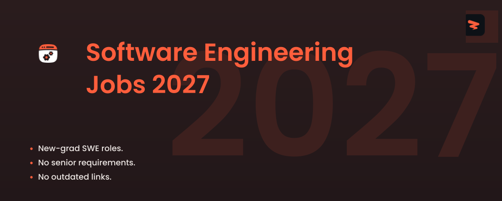

<!-- Cover -->

# Software Engineering Jobs 2027

🚀 Software engineering jobs for new graduates, updated every 10 minutes.

  
  
  
  

---

## **Website & Autofill Extension**

Explore Zapply's website and check out:

- Our Chrome extension, which autofills job applications in seconds.
- A dedicated job board featuring the latest openings across various roles.
- User accounts with multiple profiles for different resume types and roles.
- Job application tracking with streaks and commitment awards.

Experience an advanced career journey with us! 🚀

  

## Explore Around

Connect and seek advice from a growing network of fellow students and new grads.

  
  &nbsp;&nbsp;
  

---

 

<h3>💻 <strong>Software Engineering</strong></h3>

| Company | Role | Location | Posted | Visa | **Apply** |
|---------|------|----------|--------|------|----------|
| **Booz Allen Hamilton** | University, Software Engineer Intern | Fayetteville, NC | 12m | ✅ Sponsor |  |
| **AeroVironment** | Software Engineering Intern | Moorpark, CA | 22m |  |  |
| **RTX** | Software Engineer I, Onsite | IA-CEDAR RAPIDS | 41m | ✅ Sponsor |  |
| **Boeing** | Data Fusion Systems Software Engineer/Analyst (Associate, Experienced or Senior) | Berkeley, MO | 42m | ✅ Sponsor |  |
| **Cisco** | Software Engineer Data & AI PhD (Intern) - United States | San Jose California US | 42m | ✅ Sponsor |  |
| **Entrust** | Software Engineering Co-op | MN | 1h | ✅ Sponsor |  |
| **Sierra Nevada Corporation** | Software Engineer I | Plano, TX - TX_TP3 | 1h |  |  |
| **Carnegie Mellon SEI** | AI Security Software Engineer Intern – Summer 2027 | Pittsburgh, PA | 2h |  |  |
| **Cox** | Software Engineering Intern - Summer 2027 (Atlanta, GA) | Atlanta GA | 2h | ✅ Sponsor |  |
| **Carnegie Mellon University** | AI Security Software Engineer Intern – Summer 2027 | Pittsburgh, PA | 5h | ✅ Sponsor |  |
| **Northrop Grumman** | 2027 Software Engineering Intern - Boulder CO | United States-Colorado-Boulder | 7h |  |  |
| **Northrop Grumman** | 2027 Software Engineering Intern - Colorado Springs | United States-Colorado-Colorado... | 7h |  |  |
| **Northrop Grumman** | 2027 Software Engineering Intern - Aurora CO | United States-Colorado-Aurora | 7h |  |  |
| **Axon** | Software Engineer I | Seattle, Washington, United States | 7h |  |  |
| **Impulse Space** | Enterprise Software Engineering Intern (Summer 2027) | Redondo Beach, California | Date unknown |  |  |
| **Wellmark, Inc.** | Software Engineer Internship – Technology Health Plan | Des Moines, IA | 12h | ✅ Sponsor |  |
| **Carrier Global** | Software Engineering Intern - Summer | CAN | 1d |  |  |
| **Boeing** | Software Engineer   Vehicle Management Systems (Associate or Experienced) | USA - Seal Beach, CA | 1d | ✅ Sponsor |  |
| **Boeing** | Application Software Engineer, Phantom Works (Experienced or Senior) | Berkeley, MO | 1d | ✅ Sponsor |  |
| **Salesforce** | Software Engineering SMTS / LMTS - AI Core (REMOTE) | California - San Francisco | 1d | ✅ Sponsor |  |
| **Sierra Nevada Corporation** | Software Engineer Intern - Summer 2027 (For SNC Summer 2026 Interns Only) | Lone Tree, CO | 1d |  |  |
| **AutoStore** | Software Engineering Coop | Atlanta, GA, USA | 1d |  |  |
| **Axiom Space** | Software Engineering Intern (Summer 2027) | Houston | 1d |  |  |
| **CACI** | Software Development Intern - Summer 2027 | Ashburn, VA, US | 1d | ✅ Sponsor |  |
| **Cisco** | Software Engineer Data & AI PhD (Intern) - United States | San Jose, California | 1d | ✅ Sponsor |  |
| **Affirm** | Software Engineer I, Fullstack (Search) | Remote US | 1d | ✅ Sponsor |  |
| **Leidos** | Jr. Software Engineer Intern | Tucson, AZ | 1d | ✅ Sponsor |  |
| **Leidos** | Junior Software Engineer | Tucson, AZ | 1d | ✅ Sponsor |  |
| **RTX** | Software Engineer Intern | AZ-TUCSON | 1d | ✅ Sponsor |  |
| **RTX** | Software Engineer I - Test | AZ-TUCSON | 1d | ✅ Sponsor |  |
| **Muon Space** | Ground Software Engineering Intern (Summer 2027) | San Jose, CA | 1d |  |  |
| **Comcast** | Junior Software Engineer- 4 Days Onsite- Englewood, CO- FreeWheel | CO - Englewood | 1d | ✅ Sponsor |  |
| **T-Mobile** | Summer 2027 Software Engineering Intern | Bellevue, Washington | 1d | ✅ Sponsor |  |
| **Booz Allen Hamilton** | C++ Software Engineer, Junior | Beavercreek, OH | 2d | ✅ Sponsor |  |
| **Nissan** | Software Engineer Intern - Spring 2027 - Santa Clara, CA | Santa Clara, California -... | 2d |  |  |
| **Salesforce** | Software Engineering LMTS | California - San Francisco | 2d | ✅ Sponsor |  |
| **Salesforce** | Software Engineering AMTS (College Grad) | California San Francisco | 2d | ✅ Sponsor |  |
| **Sierra Nevada Corporation** | Software Engineer Intern (For SNC Summer 2026 Intern Only) | Sparks, NV | 2d |  |  |
| **ICF** | 2027 Summer Intern, Software Engineer (Reston, VA) | Reston, VA | 2d |  |  |
| **Brunswick** | Mercury Marine: G3 Software Engineering Intern | Oshkosh, WI | 2d | ✅ Sponsor |  |
| **Tessera Labs** | Software Engineering Intern, Full Stack | San Jose | 2d | ✅ Sponsor |  |
| **KION Group** | Software Engineering Intern | Grand Rapids MI United States | 2d |  |  |
| **CACI** | Software Engineering Intern - Summer 2027 | Florham Park, NJ, US | 2d | ✅ Sponsor |  |
| **Dow Jones** | Summer 2027 Internship Program – Software Engineering Intern | NYC | 2d | ✅ Sponsor |  |
| **Freedom Technology Solutions Group** | Junior Software Developer 795 | Annapolis Junction, MD | 2d |  |  |
| **Figure AI** | Embedded Software Engineering Intern \[Winter 2027\] | San Jose, CA | 2d | ✅ Sponsor |  |
| **Skydio** | Manufacturing Software Engineer Intern - Winter 2027 | San Mateo, California, United... | 2d | ✅ Sponsor |  |
| **CLEAR** | Software Development Engineer I | Austin, Texas | 2d |  |  |
| **Point72** | 2027 Summer Internship – Software Engineer | New York, NY | 2d | ✅ Sponsor |  |
| **Parsons** | Software Engineering Intern (Summer 2027) | AL, Huntsville, R187299 | Date unknown |  |  |
| **AeroVironment** | Software Engineer (EMB), I | 14501 Princeton Moorpark, CA | 3d |  |  |
| **AeroVironment** | Software Engineer (EMB) I | 14501 Princeton Moorpark, CA | 3d |  |  |
| **KLA** | Software Engineer Intern - AI | Ann Arbor, MI | 3d | ✅ Sponsor |  |
| **KLA** | Software Engineering Intern | Ann Arbor, MI | 3d | ✅ Sponsor |  |
| **Nightwing** | Junior Software Engineer  (SWE0) | Annapolis Junction, MD | 3d |  |  |
| **DriveTime** | Software Engineering Intern (Summer 2027) | 1720 W Rio Salado Pkwy Tempe,... | 3d |  |  |
| **NVIDIA** | SoC Software Engineer - New College Grad 2027 | US, CA, Santa Clara | 3d | ✅ Sponsor |  |
| **NVIDIA** | SoC Software Engineer – New College Graduate 2026 | US, CA, Santa Clara | 3d | ✅ Sponsor |  |
| **Oracle** | Software Development Snr Manager | Santa Clara, CA, United States | 3d | ✅ Sponsor |  |
| **Cisco** | Software Engineer Full Stack / Backend II (Intern) – United States | San Jose, California | 3d | ✅ Sponsor |  |
| **Blue Origin** | Summer 2027 Software Developer Internship - Undergraduate | Greater Seattle Area | 3d |  |  |
| **Blue Origin** | Summer 2027 Software Developer Internship - Graduate | Greater Seattle Area | 3d |  |  |
| **Silicon Labs** | Software Engineer I | Austin | 3d | ✅ Sponsor |  |
| **Schweitzer Engineering Laboratories** | Software Engineer Intern | Washington - Spokane Valley | Date unknown | ✅ Sponsor |  |
| **ServiceNow** | AI Engineering - Assoc Software Engineer Internships - Summer 2027 (Bachelors) | Santa Clara, CALIFORNIA | 3d | ✅ Sponsor |  |
| **ServiceNow** | AI Engineering - Software Engineer Internships - Summer 2027 (Masters) | Santa Clara, CALIFORNIA | 3d | ✅ Sponsor |  |
| **Skydio** | Software Engineer Intern - Summer 2027 | San Mateo, California, United... | 3d | ✅ Sponsor |  |
| **Skydio** | Embedded Software Engineer Intern - Summer 2027 | San Mateo, California, United... | 3d | ✅ Sponsor |  |
| **Figma** | PhD Intern, Software Engineer - Graphics (2027) | San Francisco, CA • New York, NY | 3d | ✅ Sponsor |  |
| **Motorola Solutions** | Software Engineer Co-op Intern - 2026/2027 | Illinois Remote Work, More... | 3d | ✅ Sponsor |  |
| **Symbotic** | Intern- Software Engineer | USA Wilmington,  MA - | 4d | ✅ Sponsor |  |
| **NVIDIA** | NVIDIA 2027 Internships: Software Engineering | US, CA, Santa Clara | 4d | ✅ Sponsor |  |
| **Cboe** | Software Engineer Intern (C++) | Kansas City, MO | 4d | ✅ Sponsor |  |
| **Copart** | Software Engineering Intern | Dallas, TX - Headquarters | 4d | ✅ Sponsor |  |
| **GE Aerospace** | Engines Engineering Co-op – Computer or Software Engineering – US – Fall 2027 - Returning Students | Evendale | 4d | ✅ Sponsor |  |
| **GE Aerospace** | Engines Engineering Intern – Computer or Software Engineering – US – Summer 2027 - Returning... | Evendale | 4d | ✅ Sponsor |  |
| **KLA** | AI/ML Software Engineer - Intern | Ann Arbor, MI | 4d | ✅ Sponsor |  |
| **CACI** | Software Engineering Co-op - Summer & Fall 2027 | Danbury, CT, US | 4d | ✅ Sponsor |  |
| **Applied Materials** | New College Grad Software Engineer I (Bachelors - Santa Clara, CA) | Santa Clara,CA | 4d | ✅ Sponsor |  |
| **Comcast** | Entry-level Backend Software Engineer (Python) - Chicago - ONSITE 2X Week - FreeWheel | IL - Chicago | 4d | ✅ Sponsor |  |
| **CapTech Consulting** | Consulting Internship: Software Engineering (Summer 2027) | Richmond, VA | 4d | ✅ Sponsor |  |
| **Cboe** | Software Engineer Intern | Chicago, IL | 1w | ✅ Sponsor |  |
| **Nelnet** | Junior/Mid-Level IT Software Engineer - .NET/Web | Centennial, CO | 1w | ✅ Sponsor |  |
| **Nelnet** | Intern - IT Software Engineer .NET (Summer 2027) | Lincoln, NE | 1w | ✅ Sponsor |  |
| **Nelnet** | 2026 Summer Intern - IT Software Engineer - .NET/Web - Starting Summer 2027 | Madison, WI | 1w | ✅ Sponsor |  |
| **Aptiv** | Linux Software Development Intern | USA Home | 1w | ✅ Sponsor |  |
| **Aptiv** | Linux Software Development Intern | USA Home | 1w | ✅ Sponsor |  |
| **Astreya** | Oracle / AI-Fueled Software Engineering Across the SDLC | Remote, GA | 1w | ✅ Sponsor |  |
| **Astreya** | Oracle / AI-Fueled Software Engineering Across the SDLC | Remote, GA | 1w | ✅ Sponsor |  |
| **Becton Dickinson** | Software Engineer I | USA MD - Sparks | 1w | ✅ Sponsor |  |
| **GlobalFoundries** | Software Engineer (2027 New College Graduate) | Texas Austin | 1w | ✅ Sponsor |  |
| **GlobalFoundries** | Software Engineering Intern (Summer 2027) | Texas Austin | 1w | ✅ Sponsor |  |
| **Danaher** | Software Engineering Intern | Vista, California, United States | 1w | ✅ Sponsor |  |
| **Applied Materials** | Software Engineering Summer Intern (Masters - Santa Clara, CA) | Santa Clara,CA | 1w | ✅ Sponsor |  |
| **Arcesium** | Software Engineer Intern | New York | 1w | ✅ Sponsor |  |
| **Johnson Controls** | Software Engineering Co-Op | Burlington-Massachusetts-United... | 1w | ✅ Sponsor |  |
| **ALTEN Technology** | SAP ABAP & BTP Full Stack Developer (Entry-Level) | Foster City, California, United... | 1w |  |  |
| **Micron Technology** | Intern - IT Software Engineer | Boise, ID - Main Site | 1w | ✅ Sponsor |  |
| **Microchip Technology** | Engineer I-Software Development | TX - Houston - Compaq | 1w | ✅ Sponsor |  |
| **ByteDance** | Software Engineer Project Intern (Developer Infrastructure) - 2027 Start | San Jose, California | Date unknown | ✅ Sponsor |  |

Apply for more jobs at

<h3>🤖 <strong>AI / ML Engineering</strong></h3>

| Company | Role | Location | Posted | Visa | **Apply** |
|---------|------|----------|--------|------|----------|
| **State Street** | Junior SIEM Data Engineer | Quincy, Massachusetts | 41m | ✅ Sponsor |  |
| **The Travelers Companies** | Data Engineer I (Databricks, AWS, Python) | CT Hartford | 2h |  |  |
| **CACI** | Junior Data Analyst | Florham Park, NJ, US | 2h | ✅ Sponsor |  |
| **Snowflake** | Product Marketing, AI-Powered Data Engineering Intern (Spring 2027) | CA-Menlo Park | 7h | ✅ Sponsor |  |
| **Thales** | AI Engineer - Graduate | Orlando | 1d |  |  |
| **Cox** | Data Engineer I | Carmel IN | 2d | ✅ Sponsor |  |
| **Anduril** | Winter 2027 Research Engineer Co-op | Santa Ana, California, United... | 2d |  |  |
| **General Motors** | R&D Researcher – AI and Machine Learning | Warren, Michigan, United States... | 3d | ✅ Sponsor |  |
| **General Motors** | Entry-Level – AI/Machine Learning Researcher | Mountain View, California,... | 4d | ✅ Sponsor |  |
| **Nissan** | Financial AI Engineering Intern - Summer 2027 - Franklin, TN | Franklin, Tennessee - United... | 4d |  |  |
| **The Travelers Companies** | Data Engineer I (AWS, Python, SQL) | CT Hartford | 4d |  |  |
| **Duolingo** | AI Research Engineer, New PhD Graduate | New York, NY | 4d | ✅ Sponsor |  |
| **State Street** | Artificial Intelligence & Machine Learning, AVP | Quincy, Massachusetts | 1w | ✅ Sponsor |  |
| **Intel** | Software Research Engineering - (PhD Intern) | US, Oregon, Hillsboro | 1w | ✅ Sponsor |  |
| **RTX** | AI Engineering Intern (Summer 2027) | NY-REMOTE | 1w | ✅ Sponsor |  |
| **Perpay** | Super Day - Data Engineering Internship | Philadelphia, Pennsylvania,... | 1w | ✅ Sponsor |  |
| **NVIDIA** | Research Scientist, Autonomous Systems and Physical AI Research - PhD New College Grad 2026 | US, CA, Santa Clara | 1w | ✅ Sponsor |  |
| **Booz Allen Hamilton** | Data Scientist, Junior | San Diego, CA | 1w | ✅ Sponsor |  |
| **ByteDance** | Data Lake Infrastructure & Data Analytics Research Engineer Intern (AML-Ark-US) - 2027 Summer | Seattle, Washington | Date unknown | ✅ Sponsor |  |
| **ByteDance** | Data Lake Infrastructure & Data Analytics Research Engineer Intern (AML-Ark-US) - 2027 Summer | San Jose, California | Date unknown | ✅ Sponsor |  |
| **Crowe** | Machine Learning Intern | Chicago, IL | 2w |  |  |
| **Moderna** | Co-Op, Research Engineering and AI Integration | Cambridge, Massachusetts, Research | 2w |  |  |
| **GE Vernova** | GE Vernova - Machine Learning Software Intern - Summer 2027 | Bellevue | 2w | ✅ Sponsor |  |
| **Cisco** | Security Research Engineer I (Intern) - United States | Research Triangle Park, North... | 2w | ✅ Sponsor |  |
| **First Solar** | Data Engineering Intern (Spring 2027) | Perrysburg, OH, United States | 3w | ✅ Sponsor |  |
| **Jabil** | Data Engineering Intern | St. Petersburg/Tampa, FL | 3w | ✅ Sponsor |  |
| **Geneva Trading** | PMO Data Engineering Intern | Chicago | 3w |  |  |
| **Together AI** | Systems Research Engineer Intern - GPU Programming (Winter 2027) | San Francisco | 4w | ✅ Sponsor |  |
| **Together AI** | Systems Research Engineer Intern - GPU Programming (Summer 2027) | San Francisco | 4w | ✅ Sponsor |  |
| **Qualcomm** | Machine Learning & Artificial Intelligence Engineering Internship – Summer 2027 | San Diego, CA | 4w | ✅ Sponsor |  |
| **Leidos** | Research Engineer Intern | Pittsburgh, PA | 4w | ✅ Sponsor |  |
| **Campbell Soup Company** | Data Engineer – Agentic AI & ML Ops (Co-op) | USA - NJ - Camden | 1mo |  |  |
| **Tencent** | Machine Learning Intern | California-Palo Alto | 1mo | ✅ Sponsor |  |
| **NREL** | Graduate (Year-Round) Intern: Geospatial Data Science Modeling and Analysis | Golden, CO | 1mo | ✅ Sponsor |  |
| **Marmon Holdings** | Data Engineering Intern OR Student Co-Op | Milwaukee, WI | 1mo |  |  |
| **Crowe** | AI Engineering Intern | Chicago IL USA | 1mo |  |  |
| **Intel** | System Technology Research Engineer - (PhD Intern) | Oregon Hillsboro | 1mo | ✅ Sponsor |  |
| **Capital One** | Current PhD, AI Engineering Internship Program - Summer 2027 | New York, NY | 1mo | ✅ Sponsor |  |
| **Capital One** | Current Master's, AI Engineering Internship Program - Summer 2027 | New York, NY | 1mo | ✅ Sponsor |  |
| **Cisco** | Security Research Engineer I (Intern) - United States | RTP North Carolina US | 1mo | ✅ Sponsor |  |
| **AspenTech** | Data Science Intern - Summer 2027 - Bedford, MA | Bedford, Massachusetts | 1mo | ✅ Sponsor |  |
| **Booz Allen Hamilton** | University - 2027 Summer Games Data Scientist Intern - Ft. Walton Beach, FL | Fort Walton Beach, FL | 1mo | ✅ Sponsor |  |
| **Booz Allen Hamilton** | University - 2027 Summer Games Data Scientist Intern - Annapolis Junction, MD | Annapolis Junction, MD | 1mo | ✅ Sponsor |  |
| **Gecko Robotics** | AI/Machine Learning Engineering Intern | New York City | 1mo | ✅ Sponsor |  |
| **LabCorp** | Intern - Data Science - Oncology | Baltimore MD | 1mo | ✅ Sponsor |  |
| **DV Trading** | AI Engineer Intern - Summer 2027 | Chicago | 1mo |  |  |
| **Rivian and Volkswagen Group Technologies** | Data Engineering Intern - AI & Analytics (January - August 2027) | Palo Alto, California | 1mo | ✅ Sponsor |  |
| **Solidigm** | 2027 Graduate Software, Firmware & AI Engineering Internships - US | Rancho Cordova, CA | 1mo |  |  |
| **Intel** | System Technology - Research Engineer (PhD Intern) | Oregon Hillsboro | 1mo | ✅ Sponsor |  |
| **Emerson Electric** | Data Science Engineering Intern | Boulder, CO, United States | 1mo | ✅ Sponsor |  |
| **Motorola Solutions** | Supply Chain Applied AI Engineering Intern | Chicago, IL, More... | 1mo | ✅ Sponsor |  |
| **True Anomaly** | Data Engineer I | Denver, CO | 1mo |  |  |
| **Netflix** | Machine Learning/AI Infrastructure Engineering Intern (AI Platform) PhD, Winter 2027 | Los Gatos, California | 1mo | ✅ Sponsor |  |
| **The Nuclear Company** | Summer 2027 Data Science Intern | Washington, DC | 2mo |  |  |
| **The Nuclear Company** | Summer 2027 AI/ML Engineering Intern | Washington, DC | 2mo |  |  |
| **The Nuclear Company** | Spring 2027 Data Science Intern | Washington, DC | 2mo |  |  |
| **Yotta Labs** | Research Engineer Intern - AI Systems | United States | 2mo | ✅ Sponsor |  |
| **Magna** | R&D- Computer Vision Engineering Intern | Troy, Michigan, US | 2mo | ✅ Sponsor |  |
| **Jump Trading** | Campus AI Research Engineer – Research Automation (Intern) | Chicago | 3mo | ✅ Sponsor |  |
| **Jump Trading** | Campus AI Research Engineer - Deep Learning (Intern) | Chicago | 3mo | ✅ Sponsor |  |
| **Jump Trading** | Campus AI Research Engineer (Intern) | Chicago | 3mo | ✅ Sponsor |  |
| **Perpay** | Data Engineering Internship, Summer 2027 | Philadelphia, Pennsylvania,... | 37mo | ✅ Sponsor |  |

Apply for more jobs at

<h3>🔒 <strong>Infrastructure & Security</strong></h3>

| Company | Role | Location | Posted | Visa | **Apply** |
|---------|------|----------|--------|------|----------|
| **ICF** | 2027 Summer Intern, Cloud Engineer (AWS/Azure) (Reston, VA) | Reston, VA | 2h |  |  |
| **Leidos** | Cloud Engineering Intern | 6314 Remote/Teleworker US | 8h | ✅ Sponsor |  |
| **RTX** | Battlespace Cybersecurity Researcher I | IA-CEDAR RAPIDS | 8h | ✅ Sponsor |  |
| **Together AI** | Hardware Security Engineer, New Grad (2027) | San Francisco | 1d | ✅ Sponsor |  |
| **Together AI** | Hardware Security Engineer Intern (Summer 2027) | San Francisco | 1d | ✅ Sponsor |  |
| **Daimler Truck** | Automation Engineer Intern | Gastonia, NC US | 1d | ✅ Sponsor |  |
| **NREL** | Graduate (10-12 weeks) Intern - AI/ML for Cybersecurity | Golden, CO | 1d | ✅ Sponsor |  |
| **Sierra Nevada Corporation** | Systems Security Engineer I | Lone Tree, CO | 1d |  |  |
| **CACI** | Software Test Engineer Intern - Spring 2027 | Remote | 1d | ✅ Sponsor |  |
| **LLNL** | Cybersecurity Undergraduate Intern - Cyber and Critical Infrastructure Summer Institute - Summer... | Livermore, CA | 1d | ✅ Sponsor |  |
| **LLNL** | Cybersecurity Graduate Intern - Cyber and Critical Infrastructure Summer Institute - Summer 2027 | Livermore, CA | 1d | ✅ Sponsor |  |
| **CFS Energy** | Intern - AI & Infrastructure Engineer - Spring 2027 | Devens, MA | 1d |  |  |
| **1Password** | Junior Security Engineer | Remote (United States  Canada) | 1d |  |  |
| **General Matter** | Summer 2027 Internship - Information Security Engineer | Los Angeles, CA | 1d |  |  |
| **Pfizer** | Automation Engineering Team Lead | United States - North Carolina... | 2d | ✅ Sponsor |  |
| **GDIT** | Network Security Engineer Junior | USA VA Ashburn | 2d | ✅ Sponsor |  |
| **GDIT** | Penetration Tester Junior | USA VA Ashburn | 2d | ✅ Sponsor |  |
| **Cisco** | Site Reliability Engineer I (Full Time) — United States | RTP North Carolina US | 2d | ✅ Sponsor |  |
| **Dell Technologies** | Cybersecurity Undergraduate Intern | Round Rock, TX, United States | 2d |  |  |
| **Northrop Grumman** | 2027 S/W Cybersecurity Intern – Annapolis MD | United States-Maryland-Annapolis | 2d |  |  |
| **RTX** | Battlespace Cybersecurity Researcher | IA-CEDAR RAPIDS | 2d | ✅ Sponsor |  |
| **Boeing** | DevOps Developer (Experienced or Senior) | USA - Seal Beach, CA | 3d | ✅ Sponsor |  |
| **RTX** | Mechanical Automation Engineering Intern (Summer 2027) | TX-MCKINNEY | 3d | ✅ Sponsor |  |
| **TP-Link USA** | Penetration Tester, Embedded Devices | Irvine, California | 3d |  |  |
| **TP-Link USA** | Penetration Tester, Web/Mobile Apps and Cloud Services | Irvine, California | 3d |  |  |
| **Emerson Electric** | Controls & Automation Engineering Co‑Op –  Latham, NY - Summer 2027 | Latham, NY, United States | 3d | ✅ Sponsor |  |
| **Cisco** | Site Reliability Engineer I (Full Time) — United States | Research Triangle Park, North... | 3d | ✅ Sponsor |  |
| **Blue Origin** | Summer 2027 Test Engineering Internship - Graduate | Van Horn, TX | 3d |  |  |
| **Blue Origin** | Summer 2027 Test Engineering Internship - Undergraduate | Greater Seattle Area | 3d |  |  |
| **Draper** | Classified Cybersecurity/IT Internship (Summer 2027) | Cambridge, MA | 3d |  |  |
| **Leidos** | Junior Security Engineer | Bethesda, MD | 3d | ✅ Sponsor |  |
| **Bosch Group** | Information Security and Privacy Intern | Farmington Hills, MI | 4d | ✅ Sponsor |  |
| **Elevance Health** | Information Security Advisor | GA-ATLANTA | 1w | ✅ Sponsor |  |
| **Boeing** | Site Reliability Engineer (Associate, Experienced, or Senior) | USA - Berkeley, MO | 1w | ✅ Sponsor |  |
| **BorgWarner** | Systems Test Automation Engineering Intern | Kokomo Technical | 1w | ✅ Sponsor |  |
| **CACI** | Cyber Security Intern - Summer 2027 | Springfield, VA, US | 1w | ✅ Sponsor |  |
| **Allison Transmission** | IT Security Analyst Internship - Summer 2027 | Indianapolis, IN | 1w |  |  |
| **Arcesium** | Infrastructure Engineer Intern | New York | 1w | ✅ Sponsor |  |
| **Philips** | Intern - System Test Automation Engineer – San Diego, CA – Summer 2027 | San Diego, California, United... | 1w | ✅ Sponsor |  |
| **Atlantic Health System** | Cybersecurity Engineer I | Morristown, NJ, United States | 1w |  |  |
| **Jabil** | Automation Engineering Intern | Clinton, MA | 1w | ✅ Sponsor |  |
| **GDIT** | Systems Administrator_TS/SCI with Polygraph | USA CA Sacramento | 1w | ✅ Sponsor |  |
| **JLL** | Automation Engineering Apprentice | WINDSOR, CT | 1w | ✅ Sponsor |  |
| **Baker Hughes** | Quality Assurance Engineering | NV-MINDEN | 1w |  |  |
| **Verizon** | Junior Security Engineer | Basking Ridge, New Jersey | 1w |  |  |
| **JLL** | Automation Engineering Apprentice | Niagara Falls, NY | 1w | ✅ Sponsor |  |
| **F5** | Executive Assistant - Infrastructure Engineering | Seattle | 1w | ✅ Sponsor |  |
| **NREL** | Undergraduate / Graduate (Spring / Summer) Intern - Cyber Security Research – 5G | Golden, CO | 1w | ✅ Sponsor |  |
| **Expedia Group** | Security Engineering Intern - 2027 - Seattle | Washington - Seattle | 1w | ✅ Sponsor |  |
| **Graco** | Cybersecurity Intern | Dayton, Minnesota, USA | 1w | ✅ Sponsor |  |
| **TD Bank** | 2027 Summer Internship Program - Global Technology & Solutions - Cloud/DevOps | Mount Laurel, New Jersey | 1w | ✅ Sponsor |  |
| **TD Bank** | 2027 Summer Internship Program - Global Technology & Solutions - Cyber Security | Mount Laurel, New Jersey | 1w | ✅ Sponsor |  |
| **Vanguard** | College to Corporate IT Internship-Risk & Security Engineer (PA) | Malvern, PA | 2w | ✅ Sponsor |  |
| **Pentair** | IT & Cybersecurity Leadership Development Internship Program -  Summer 2027 | Golden Valley, MN | 2w |  |  |
| **Cox** | Cybersecurity Intern - Summer 2027 | Atlanta GA | 2w | ✅ Sponsor |  |
| **CACI** | Network / Cybersecurity Intern - Summer 2027 | High Point, NC, US | 2w | ✅ Sponsor |  |
| **Federal Reserve System** | Summer 2027 Intern-Cloud Engineering | Chicago, IL | 2w |  |  |
| **Federal Reserve System** | Summer 2027 Intern-Cybersecurity and Information Security | Chicago, IL | 2w |  |  |
| **UPS** | UPS Information Security Summer 2027 Internship - NJ | MAHWAH, New Jersey | 2w |  |  |
| **Impulse Space** | Information Security Intern (Summer 2027) | Redondo Beach, California | Date unknown |  |  |
| **ByteDance** | Site Reliability Engineer Intern (Data Infra) - 2027 Summer | Seattle, Washington | Date unknown | ✅ Sponsor |  |
| **ByteDance** | Production System Engineer Project Intern (Server DevOps) - 2027 Start | San Jose, California | Date unknown | ✅ Sponsor |  |
| **ByteDance** | Production System Engineer Project Intern (Server DevOps) - 2027 Start | New York, New York | Date unknown | ✅ Sponsor |  |
| **SeatGeek** | Security Engineer - Internship | New York, New York | 2w | ✅ Sponsor |  |
| **Varda Space** | Cybersecurity Internship - Summer 2027 | El Segundo, California, United... | 2w |  |  |
| **Marvell** | Test Engineering Intern, MS - Summer 2027 | Santa Clara, CA | 2w | ✅ Sponsor |  |
| **Wellmark, Inc.** | Security Analyst Internship | Des Moines, IA | 2w | ✅ Sponsor |  |
| **Grant Thornton** | Cybersecurity and Privacy Associate - Summer 2027 | Los Angeles, CA, United States | 2w | ✅ Sponsor |  |
| **LabCorp** | Intern – Network Infrastructure & Automation Engineering | Durham NC | 2w | ✅ Sponsor |  |
| **Copart** | Vulnerability Management Engineering Intern | Dallas, TX - Headquarters | 2w | ✅ Sponsor |  |
| **Philips** | Intern – Embedded Systems Test Automation Engineer – Bothell, WA – Summer 2027 | Bothell, Washington, United States | 2w | ✅ Sponsor |  |
| **GM Financial** | Intern - Cybersecurity | Irving, TX, United States | 2w |  |  |
| **GM Financial** | Intern - Cybersecurity | Arlington, TX, United States | 2w |  |  |
| **Cisco** | Security Engineer I (Full Time) - United States | Research Triangle Park, North... | 2w | ✅ Sponsor |  |
| **AbbVie** | 2027 Business Technology Solutions Intern - Cloud Engineering (Undergraduate) | South San Francisco, CA | 3w | ✅ Sponsor |  |
| **AbbVie** | 2027 Business Technology Solutions Intern - Cloud Engineering (Undergraduate) | Irvine, CA | 3w | ✅ Sponsor |  |
| **AbbVie** | 2027 Business Technology Solutions Intern - Cloud Engineering (Undergraduate) | North Chicago, IL | 3w | ✅ Sponsor |  |
| **UPS** | UPS Information Security Summer 2027 Internship - KY | LOUISVILLE, Kentucky | 3w |  |  |
| **Insulet Corporation** | Intern, DevOps Engineer: June-August 2027 (Onsite) | San Diego, California | 3w | ✅ Sponsor |  |
| **Hitachi** | Intern – Network Engineering | Pittsburgh, Pennsylvania,... | 3w | ✅ Sponsor |  |
| **Johnson & Johnson** | Software Test Engineering Co-op (Beatbox) | Danvers, Massachusetts, United... | 3w | ✅ Sponsor |  |
| **Johnson & Johnson** | Software Test Engineering Co-op (RLM) | Danvers, Massachusetts, United... | 3w | ✅ Sponsor |  |
| **Tencent** | Site Reliability Engineer (SRE) Intern — AI Infrastructure | California-Palo Alto | 3w | ✅ Sponsor |  |
| **Cox** | Quality Assurance Engineering Intern - Summer 2027 | Atlanta GA | 3w | ✅ Sponsor |  |
| **GlobalFoundries** | Robotics and Automation Engineering Intern, Junior (Summer 2027) | USA - Vermont - Essex Junction | 3w | ✅ Sponsor |  |
| **Northrop Grumman** | 2027 Intern - Systems Security/Cybersecurity Engineer | United States-Florida-Melbourne | 3w |  |  |
| **Insulet Corporation** | Co-op, DevOps Engineer: January - June 2027 (Hybrid) | Acton, Massachusetts | 3w | ✅ Sponsor |  |
| **Leidos** | Network Engineering & Operations Intern | Shiloh, IL | 3w | ✅ Sponsor |  |
| **MITRE** | Internships in Cybersecurity and Information Security | McLean, Virginia | 3w |  |  |
| **LLNL** | Computing Undergraduate Student Intern: DevOps Internship Program - Summer 2027 | Livermore, CA | 4w | ✅ Sponsor |  |
| **Johnson & Johnson** | Medical Device Cybersecurity Co-Op | Danvers, Massachusetts, United... | 4w | ✅ Sponsor |  |
| **Motorola Solutions** | Cyber Security - 2027 Summer Internship (Chicago Hybrid) | Chicago, IL, More... | 4w | ✅ Sponsor |  |
| **Qualcomm** | IT Infrastructure & Cloud Engineering Internship – Summer 2027 | San Diego, CA | 4w | ✅ Sponsor |  |
| **FIS** | Intern, Risk and Cybersecurity, FIS University Program | FL JAX 347 | 4w | ✅ Sponsor |  |
| **Motorola Solutions** | Intern - Embedded Software, System, and Test Engineer - 2026 | Irvine, CA | 1mo | ✅ Sponsor |  |
| **Motorola Solutions** | Test Engineering Internship 2027 | Greater Chicago Area | 1mo | ✅ Sponsor |  |
| **Insulet Corporation** | Co-op, Embedded Software Test Engineering: January - June 2027 (Onsite) | Acton, Massachusetts | 1mo | ✅ Sponsor |  |
| **Elevance Health** | Information Security Co-Op Internship – 2027 | 2 Locations | 1mo | ✅ Sponsor |  |
| **Monolithic Power Systems** | Security Analyst Intern | San Jose, CA | 1mo | ✅ Sponsor |  |
| **Tencent** | Cyber Security Engineer Intern | California-Palo Alto | 1mo | ✅ Sponsor |  |

Apply for more jobs at

<h3>⚙️ <strong>Systems & Embedded</strong></h3>

| Company | Role | Location | Posted | Visa | **Apply** |
|---------|------|----------|--------|------|----------|
| **Sierra Nevada Corporation** | Systems Engineering Intern - Summer 2027 (For SNC Summer 2026 Interns Only) | Lone Tree, CO | 1h |  |  |
| **General Motors** | 2027 Summer Intern, Systems Engineer, ASD | 2 Locations | 1d | ✅ Sponsor |  |
| **Nightwing** | Data Center Infrastructure Specialist | Sterling, VA | 1d |  |  |
| **Axiom Space** | Systems Engineering Intern (Summer 2027) | Houston | 1d |  |  |
| **Saronic Technologies** | Systems Engineer I | Austin, TX | 1d |  |  |
| **Philips** | Intern – Systems Engineering (Sustaining & Design Controls) - San Diego, CA - Summer 2027 | San Diego, California, United... | 2d | ✅ Sponsor |  |
| **Moog** | Intern, Systems Engineering | Buffalo, NY | 2d |  |  |
| **Boeing** | Entry Level B1 Software Systems Engineer | Tinker AFB, OK | 2d | ✅ Sponsor |  |
| **Blue Origin** | Summer 2027 Electrical Systems Engineering Internship - Graduate | Greater Seattle Area | 2d |  |  |
| **Blue Origin** | Summer 2027 Aerospace Systems Engineering Intern - Graduate | Greater Seattle Area | 2d |  |  |
| **Blue Origin** | Summer 2027 Electrical Systems Engineering Internship - Undergraduate | Greater Seattle Area | 2d |  |  |
| **Northrop Grumman** | 2027 S/W Embedded Engineering Intern – Annapolis MD | United States-Maryland-Annapolis | 2d |  |  |
| **SharkNinja** | Spring 2027: Mechanical Systems Engineering Co-op, Ninja (January to June) | Needham, MA, United States | 2d | ✅ Sponsor |  |
| **AeroVironment** | Summer 2027 Autonomy & Robotics Engineering Intern | Simi Valley, CA | 3d |  |  |
| **GDIT** | Systems Engineer Junior to Senior LEVELS | MD Germantown | 3d | ✅ Sponsor |  |
| **Boeing** | Software Systems Engineer (Associate or Experienced) | USA - Seal Beach, CA | 3d | ✅ Sponsor |  |
| **Boeing** | Software Systems Engineer (Associate or Experienced) | USA - Colorado Springs, CO | 3d | ✅ Sponsor |  |
| **Aerospace Corporation** | 2027 Power Systems Engineering Undergraduate Intern | El Segundo, CA | 3d |  |  |
| **Aerospace Corporation** | 2027 Power Systems Engineering Graduate Intern | El Segundo, CA | 3d |  |  |
| **Marvell** | Firmware Engineer Intern, BS - Summer 2027 | Santa Clara, CA | 3d | ✅ Sponsor |  |
| **CACI** | Systems Engineer Intern - Summer 2027 | Ashburn, VA, US | 3d | ✅ Sponsor |  |
| **UPS** | Buildings and Systems Engineering Specialist (BaSE) | NASHVILLE, Tennessee | 3d |  |  |
| **CVS Health** | Delivery Driver/RX Tech, Back End Part Time | FL - Sanford | 3d | ✅ Sponsor |  |
| **VAST** | Fluid Systems Engineering | Long Beach, California, United... | 3d |  |  |
| **GE Aerospace** | Systems Engineering Co-op - Electrical Engineering & Computer Engineering/Science (Avionics) -... | Grand Rapids | 4d | ✅ Sponsor |  |
| **GE Aerospace** | Systems Engineering Co-op - Mechanical/Aerospace Engineering (Electric Power) - US - Fall 2027 -... | Dayton | 4d | ✅ Sponsor |  |
| **GE Aerospace** | Systems Engineering Co-op - Electrical Engineering & Computer Engineering/Science (Electric... | Dayton | 4d | ✅ Sponsor |  |
| **LLNL** | Engineering Technical Associate - Laser Systems Engineering and Operations Division | Livermore, CA | 4d | ✅ Sponsor |  |
| **CVS Health** | Delivery Driver/Rx Tech Back End Full Time | FL - Tampa | 4d | ✅ Sponsor |  |
| **HPE (University)** | Firmware Engineering Intern | Sunnyvale, California, United... | 4d | ✅ Sponsor |  |
| **DV Trading** | Data Center Engineer Intern - Summer 2027 | Chicago | 4d |  |  |
| **Caterpillar** | Site Systems Engineering Specialist – Construction Applications | Irving, Texas | 1w | ✅ Sponsor |  |
| **UPS** | Buildings & Systems Engineering Maintenance Mechanic | HOUSTON, Texas | 1w |  |  |
| **MITRE** | Systems Engineering Intern | Bedford, Massachusetts | 1w |  |  |
| **Applied Materials** | Systems Engineer, New College Grad- Bachelor's/Master's (Santa Clara, CA) | Santa Clara,CA | 1w | ✅ Sponsor |  |
| **CFS Energy** | Intern - Nuclear/Systems Engineer - Summer 2027 | Devens, MA | 1w |  |  |
| **Amazon.com Services LLC** | Robotics Systems Engineer I, Tech Deployment | Seattle, WA | 1w | ✅ Sponsor |  |
| **Cummins** | Systems Engineering Product Specialist | Seattle, WA, United States | 1w | ✅ Sponsor |  |
| **Cummins** | Systems Engineering Product Specialist | Seattle, WA, United States | 1w | ✅ Sponsor |  |
| **MITRE** | Systems Engineer Intern | McLean, Virginia | 1w |  |  |
| **UPS** | Buildings and Systems Engineering Union Specialist | HOUSTON, Texas | 1w |  |  |
| **MITRE** | Systems Engineering Intern | McLean, Virginia | 1w |  |  |
| **AeroVironment** | Systems Engineer I | Petaluma, CA | 1w |  |  |
| **Nissan** | Systems Engineer Intern - Summer 2027 - Canton, MS | Canton, Mississippi - United... | 1w |  |  |
| **Caterpillar** | Control Systems Engineering Specialist | Mossville, Illinois | 1w | ✅ Sponsor |  |
| **Thorlabs** | Photonics Systems Engineer I | Newton, New Jersey | 1w |  |  |
| **Philips** | Intern –Systems Engineering, Oral Healthcare – Bothell, WA – Summer 2027 | Bothell, Washington, United States | 1w | ✅ Sponsor |  |
| **Generac** | Micro-Grid Systems Engineering Co-Op | USA - CO Fort Collins | 1w | ✅ Sponsor |  |
| **Amazon.com Services LLC** | Robotics Systems Engineer I, Robotics Delivery & Packaging Innovations (RDPI) Technology Deployment | N.reading, MA | 1w | ✅ Sponsor |  |
| **Torc Robotics** | Commissioning - Systems Engineer I | Ann Arbor, MI | 1w | ✅ Sponsor |  |
| **Hitachi** | Controls Engineering Internship/Co-op | Liberty, South Carolina, United... | 1w | ✅ Sponsor |  |
| **Hitachi** | Controls Engineering Internship/Co-op | Holland, Michigan, United States | 1w | ✅ Sponsor |  |
| **Hitachi** | Controls Engineering Internship/Co-op | Auburn Hills, Michigan, United... | 1w | ✅ Sponsor |  |
| **SoloPulse** | RF Hardware Engineer Intern | Peachtree Corners, GA | 1w |  |  |
| **Marvell** | Firmware Engineer Intern, MS - Summer 2027 | Santa Clara, CA | 2w | ✅ Sponsor |  |
| **ABB** | Systems Engineering Intern - Summer 2027 | USA, OH, Cleveland | 2w | ✅ Sponsor |  |
| **KLA** | Mechatronics/Systems Engineering Internship | Milpitas, CA | 2w | ✅ Sponsor |  |
| **Trane Technologies** | Systems Engineer Intern | St Paul, Minnesota | 2w | ✅ Sponsor |  |
| **Astranis** | Automation & Controls Engineering Associate (Winter 2027) | San Francisco | 2w |  |  |
| **Astranis** | Automation & Controls Engineering Associate (Summer 2027) | San Francisco | 2w |  |  |
| **Astranis** | Automation & Controls Engineering Intern (Summer 2027) | San Francisco | 2w |  |  |
| **Nike** | NIKE, Inc. Innovation Underfoot Systems Engineer Graduate Internship | Beaverton, Oregon | 2w | ✅ Sponsor |  |
| **Mill** | Systems Engineering Intern, Fall/Winter 2026 | San Bruno, California | 2w |  |  |
| **Waymo** | 2027 Summer Intern, PhD, Perception Systems Engineering: Pedestrian Detection Precision | San Francisco, California | 2w | ✅ Sponsor |  |
| **Moog** | Intern, Systems Engineering | Torrance, CA | 3w |  |  |
| **Waymo** | 2027 Summer Intern, MS/PhD, Systems Engineer, Autonomous Vehicle Networks & Diagnostics | Mountain View, CA, USA | 3w | ✅ Sponsor |  |
| **ABB** | Systems Engineering Intern – Summer 2027 | USA, OH, Cleveland | 3w | ✅ Sponsor |  |
| **Zipline** | Field Systems Engineer Intern (Spring 2027) | South San Francisco,... | 3w | ✅ Sponsor |  |
| **Sonos** | Audio Systems Engineering Co-Op | Boston, MA | 3w | ✅ Sponsor |  |
| **General Motors** | 2027 Summer Intern - Digital Product: Embedded and Systems Engineering | 4 Locations | 3w | ✅ Sponsor |  |
| **CACI** | AI Systems Engineering Intern -  Summer 2027 | Annapolis Junction MD US | 3w | ✅ Sponsor |  |
| **Xcimer Energy** | Summer 2027 Internship - Controls Systems Engineering | Denver, CO | 3w |  |  |
| **AeroVironment** | Summer 2027 Autonomy & Robotics Engineering Intern | Moorpark, CA | 3w |  |  |
| **GE Healthcare** | Summer 2027 Systems Engineering Internship | Salt Lake City | 3w |  |  |
| **Qualcomm** | Embedded Engineering Internship - Summer 2027 | San Diego, CA | 3w | ✅ Sponsor |  |
| **Insulet Corporation** | Co-op, Systems Engineering - Design Verification: January - June 2027 (Onsite) | Acton, Massachusetts | 4w | ✅ Sponsor |  |
| **Qualcomm** | Wireless Systems Engineering Internship - Summer 2027 | San Diego, CA | 4w | ✅ Sponsor |  |
| **Rocket Lab** | Systems Engineering Intern Summer 2027 | Tucson, AZ | 4w |  |  |
| **Rocket Lab** | Systems Engineering Intern Summer 2027 | Chantilly, VA | 4w |  |  |
| **Rocket Lab** | Systems Engineering Intern Summer 2027 | Pasadena, CA | 4w |  |  |
| **Allegion** | Summer Intern - Systems Engineer | Indianapolis, IN - Hague Rd | 1mo |  |  |
| **Motorola Solutions** | R&D Intern - Wireless Systems Engineer - 2026 | Los Angeles, CA | 1mo | ✅ Sponsor |  |
| **Cboe** | Linux Engineer Intern | Chicago, IL | 1mo | ✅ Sponsor |  |
| **Insulet Corporation** | Co-op, Systems Engineering: January-June 2027 (Hybrid) | Acton, Massachusetts | 1mo | ✅ Sponsor |  |
| **Insulet Corporation** | Co-op, Next Gen Platforms (NGP) Systems Engineering: January-June 2027 (Onsite) | Acton, Massachusetts | 1mo | ✅ Sponsor |  |
| **Entegris** | Manufacturing Systems Engineer Co-Op | Rockrimmon, Colorado Springs, CO | 1mo | ✅ Sponsor |  |
| **Aerospace Corporation** | 2027 Digital Systems Engineering Graduate Intern | El Segundo, CA | 1mo |  |  |
| **Magna** | Intern - Systems Engineering | Southfield, Michigan, US | 1mo | ✅ Sponsor |  |
| **Sierra Nevada Corporation** | Systems Engineer Intern (Summer 2027) | Dayton, OH | 1mo |  |  |
| **Sierra Nevada Corporation** | Systems Engineering Intern (Summer 2027) | Hagerstown, MD | 1mo |  |  |
| **Onto Innovation** | Mechanical Systems Engineer Intern | Bloomington-MN | 1mo | ✅ Sponsor |  |
| **KBR** | Data Processing Systems Engineer Intern | Sioux Falls, South Dakota | 1mo | ✅ Sponsor |  |
| **Intel** | Platform Hardware and Systems Engineering - Intern, Bachelor’s | Oregon Hillsboro | 1mo | ✅ Sponsor |  |
| **Intel** | Platform Hardware and Systems Engineering - Intern, Graduate | Oregon Hillsboro | 1mo | ✅ Sponsor |  |
| **Brunswick** | Mercury Racing Systems Engineering Co-Op | Fond du Lac, WI | 1mo | ✅ Sponsor |  |
| **Brunswick** | Mercury Marine: Software Controls Engineering Intern | Fond du Lac, WI | 1mo | ✅ Sponsor |  |
| **Caterpillar** | 2027 Summer Corporate Intern - Autonomy & Intelligent Systems Engineering | Mossville Illinois | 1mo | ✅ Sponsor |  |
| **Booz Allen Hamilton** | University - 2027 Summer Games Systems Engineer Intern - Colorado Springs, CO | Colorado Springs, CO | 1mo | ✅ Sponsor |  |
| **Booz Allen Hamilton** | University - 2027 Summer Games Systems Engineer Intern - Ft. Walton Beach, FL | Fort Walton Beach, FL | 1mo | ✅ Sponsor |  |
| **Booz Allen Hamilton** | University - 2027 Summer Games Systems Engineer Intern - Annapolis Junction, MD | Annapolis Junction, MD | 1mo | ✅ Sponsor |  |

Apply for more jobs at

<h3>📋 <strong>Solutions & Program Management</strong></h3>

| Company | Role | Location | Posted | Visa | **Apply** |
|---------|------|----------|--------|------|----------|
| **Google** | Technical Solutions Engineer I, Infrastructure, Compute, Google Cloud | United States | Date unknown | ✅ Sponsor |  |
| **F5** | Mgr, Solutions Engineering | Field, CA | 1w | ✅ Sponsor |  |
| **Intel** | AI Solutions Engineering Undergraduate Intern | US, Oregon, Hillsboro | 1mo | ✅ Sponsor |  |
| **Intel** | AI Solutions Engineering Graduate Intern | US, Oregon, Hillsboro | 1mo | ✅ Sponsor |  |

Apply for more jobs at

<h3>📂 <strong>Other Software Roles</strong></h3>

| Company | Role | Location | Posted | Visa | **Apply** |
|---------|------|----------|--------|------|----------|
| **Booz Allen Hamilton** | ServiceNow Developer, Junior | McLean, VA | 12m | ✅ Sponsor |  |
| **Crane Co.** | Engineering Intern PT | 70900-USA7900 VS USA_TWINSBURG-OH | 41m | ✅ Sponsor |  |
| **RELX** | Project Manager | Home based Georgia | 41m | ✅ Sponsor |  |
| **State Street** | Application, Infrastructure and Service Management, Officer | Burlington Massachusetts | 41m | ✅ Sponsor |  |
| **GDIT** | Software Applications Tester - TS/SCI with Polygraph | USA VA Chantilly | 42m | ✅ Sponsor |  |
| **GE Vernova** | GE Vernova - Project Engineer Intern - Summer 2027 | Bellevue | 42m | ✅ Sponsor |  |
| **Fiserv** | Business Systems Analysis - Advisor I | Frisco, Texas | 42m | ✅ Sponsor |  |
| **Boeing** | Audio Visual Programmer (Associate, Mid-Level or Senior) | USA - Herndon, VA | 42m | ✅ Sponsor |  |
| **Salesforce** | AI Labs Rotational Fellowship, Emerging Talent | California San Francisco | 53m | ✅ Sponsor |  |
| **Aerospace Corporation** | Classified Software Program Management | Chantilly, VA | 1h |  |  |
| **ASML** | Optical Fabrication Technicians: CWW Back End Nights, 6:00 PM – 6:00 AM (Wednesday, Thursday,... | Wilton, CT, USA | 1h | ✅ Sponsor |  |
| **CrowdStrike** | Employee Experience Coordinator | Sunnyvale, CA | 1h | ✅ Sponsor |  |
| **Sierra Nevada Corporation** | Project Engineer I - Development | Lone Tree, CO | 1h |  |  |
| **Sierra Nevada Corporation** | Project Engineer I | Lone Tree, CO | 1h |  |  |
| **Sierra Nevada Corporation** | Project Engineer I - Production | Lone Tree, CO | 1h |  |  |
| **The Travelers Companies** | Outside Property Claim Associate | CO Thornton | 2h |  |  |
| **KLA** | Customer Support Engineer - New College Grad | Chandler, AZ | 2h | ✅ Sponsor |  |
| **Apple** | Pre-silicon Compute and ML Framework Manager | Cupertino | 4h | ✅ Sponsor |  |
| **Amazon Development Center U.S., Inc. - B02** | Systems Development Engineer, Early Career – 2026 (US) | Seattle, WA | 4h | ✅ Sponsor |  |
| **GlobalFoundries** | Advanced Manufacturing Engineering Intern, Process & Equipment (Summer 2027) | USA - New York - Malta | 5h | ✅ Sponsor |  |
| **Sysco** | Raw Material Audit Technician | Newport Portland | 12h |  |  |
| **PNC Financial Services** | Data Expert - Data and Automation GenAI Governance | PA Pittsburgh 15219 | 13h | ✅ Sponsor |  |
| **Thomson Reuters** | VJ/Cameraperson (Level 1 Journalist - Temp Guild), | Washington District of Columbia | 1d | ✅ Sponsor |  |
| **Moderna** | Co-Op, Automation, Digital Manufacturing & Controls | Norwood, Massachusetts, Drug... | 1d |  |  |
| **Symbotic** | Co-op- Robot Manipulation | USA Wilmington,  MA - | 1d | ✅ Sponsor |  |
| **AeroVironment** | Manufacturing Engineering Intern | Pottstown, PA | 1d |  |  |
| **Q2** | 2027 Summer Internship - Finance | Austin, Texas | 1d |  |  |
| **Q2** | 2027 Summer Internship - Product Operations | Austin, Texas | 1d |  |  |
| **Q2** | 2027 Summer Internship - Marketing | Austin, Texas | 1d |  |  |
| **Boeing** | Hardware & Software Integration Engineer (Associate or Mid-Level) | Kirtland AFB, NM | 1d | ✅ Sponsor |  |
| **DraftKings** | VIP Lifecycle Associate | Boston, MA | 1d |  |  |
| **AssetMark** | Associate Data Steward | Charlotte, NC | 1d |  |  |
| **Micron Technology** | New College Grad - Computer Engineer, Central Engineering | Boise, ID - Main Site | 1d | ✅ Sponsor |  |
| **Autodesk** | PhD Researcher, Agentic 3D Modeling in Immersive Environments | New York | 1d | ✅ Sponsor |  |
| **Rocket Companies** | Summer 2027 Property Management Internships (Commercial and Residential Property Management) | Detroit, MI | 1d | ✅ Sponsor |  |
| **Rocket Companies** | Summer 2027 Architecture & Design Intern | Detroit, MI | 1d | ✅ Sponsor |  |
| **The Travelers Companies** | Outside Auto Appraiser | OH - Independence | 1d |  |  |
| **Carnegie Mellon SEI** | SEI Controller | Pittsburgh, PA | 1d |  |  |
| **Snap** | Project Manager, Global Brand Experience (Fixed-Term) | Los Angeles, California | 1d | ✅ Sponsor |  |
| **WSP** | MEP Engineering Intern - Spring 2027 | Dallas, TX, United States | 1d | ✅ Sponsor |  |
| **WSP** | Traffic Engineering Intern- Summer 2027 | Dallas, TX, United States | 1d | ✅ Sponsor |  |
| **Cisco** | Customer Success Area TAM Splunk Specialist | Richardson, Texas | 1d | ✅ Sponsor |  |
| **Jabil** | Engineering Internships - Florence, KY | Florence, KY | 1d | ✅ Sponsor |  |
| **Jabil** | Engineering Internships - Memphis, TN | Memphis, TN | 1d | ✅ Sponsor |  |
| **Jabil** | Engineering Internships - Salt Lake City, UT | Salt Lake City/Grantsville, UT | 1d | ✅ Sponsor |  |
| **Microsoft** | Security Researcher   Defender Experts | United States | 1d | ✅ Sponsor |  |
| **GlobalFoundries** | Advanced Manufacturing Engineering Intern, Process & Equipment (Summer 2027) | USA - New York - Malta | 1d | ✅ Sponsor |  |
| **Parsons** | Transportation Engineering Intern - Summer 2027 | NC, Raleigh, R187423 | Date unknown |  |  |
| **Northrop Grumman** | PC Network Support Technician 1 | United... | 1d |  |  |
| **Northrop Grumman** | 2027 Engineering Internship (Dulles VA / Baltimore MD) | United States Virginia Dulles | 1d |  |  |
| **Leidos** | Cyberspace Operations Planner, Junior | Odenton, MD | 1d | ✅ Sponsor |  |
| **RTX** | Metrology Engineering Intern (Summer 2027) | IA-CEDAR RAPIDS | 1d | ✅ Sponsor |  |
| **1Password** | Junior Developer | Remote (United States  Canada) | 1d |  |  |
| **North Wind Group** | IT Security Systems Specialist 04243 NWD | PIKETON, Ohio | 1d |  |  |
| **Microsoft** | Security Researcher | Redmond, Washington, United States | 1d | ✅ Sponsor |  |
| **Booz Allen Hamilton** | AI Researcher | Chantilly, VA | 2d | ✅ Sponsor |  |
| **Nasdaq** | Intelligent Automation Intern - 2027 Summer Internship | USA - New York City - New York | 2d | ✅ Sponsor |  |
| **Pfizer** | DSRD Necropsy and Histology Technical Assistant | United States - Connecticut -... | 2d |  |  |
| **Salesforce** | Summer 2027 Intern - Solution Engineer | New York - New York | 2d | ✅ Sponsor |  |
| **Aerospace Corporation** | 2027 Software Tools and Assurance Intern | El Segundo, CA | 2d |  |  |
| **Aerospace Corporation** | 2027 Sensor Modeling and Simulation Undergrad Intern | Chantilly, VA | 2d |  |  |
| **ASML** | Optical Surface & Mechanical Inspector CWWBack End Nights, 6:00 PM – 6:00 AM (Wednesday,... | Wilton, CT, USA | 2d | ✅ Sponsor |  |
| **Elanco** | Engineering Intern – Winslow, Maine (Summer 2027) | Winslow, ME | 2d | ✅ Sponsor |  |
| **NVIDIA** | PhD Research Intern, Security and Privacy - 2027 | CA Santa Clara | 2d | ✅ Sponsor |  |
| **NVIDIA** | AI GPU Power Architect - New College Grad 2026 | CA Santa Clara | 2d | ✅ Sponsor |  |
| **Motorola Solutions** | Product Owner (Product Data Hub) | Illinois, US Offsite, More... | 2d | ✅ Sponsor |  |
| **The Travelers Companies** | Inside Auto Appraiser | NC Charlotte | 2d |  |  |
| **Snap** | 2027 Generative Media Research Intern | Los Angeles, California | 2d | ✅ Sponsor |  |
| **CACI** | Mission IT Operator | Denver, CO, US | 2d | ✅ Sponsor |  |
| **JPMorgan Chase** | Product Delivery Manager - Identity and Access Management | Columbus, OH, United States | 2d | ✅ Sponsor |  |
| **onsemi** | Summer 2027 - Device Characterization Engineering Intern | Hopewell Junction, NY, United... | 2d |  |  |
| **Dow Jones** | Financial Translator, Spanish | NYC | 2d | ✅ Sponsor |  |
| **Dow Jones** | Summer 2027 Internship Program – Commercial Strategy Intern | NYC | 2d | ✅ Sponsor |  |
| **Dow Jones** | Summer 2027 Internship Program – Wealth & Asset Management Intern | NYC | 2d | ✅ Sponsor |  |
| **GlobalFoundries** | Advanced Manufacturing Engineering Intern, Process & Equipment (Summer 2027) | USA - New York - Malta | 2d | ✅ Sponsor |  |
| **Aptiv** | ADAS Engineering Intern – Camera Perception | Troy, MI - USA | 2d | ✅ Sponsor |  |
| **Leidos** | Junior Integration Engineer | Huntsville, AL | 2d | ✅ Sponsor |  |
| **Amentum** | Technical Order Distribution Office (TODO) Coordinator (HH-60W) | MD-Andrews AFM | 2d |  |  |
| **Parsons** | Bridge Engineering Intern - Summer 2027 | VA, Centreville, R187033 | Date unknown |  |  |
| **Anduril** | 2027 Early Career Division Operations | Reston, Virginia, United States | 2d |  |  |
| **Microsoft** | Technical Support Engineering | United States | 2d | ✅ Sponsor |  |
| **RE/SPEC Inc.** | Student Engineering Intern (Structural) | Anchorage, AK | 2d |  |  |
| **Micron Technology** | New College Grad - Computer Engineer, Engineering Automation | Richardson, TX | 2d | ✅ Sponsor |  |
| **Citi** | Research Associate - AI | New York New York United States | 2d |  |  |
| **Booz Allen Hamilton** | Identity and Access Management Specialist | McLean, VA | 3d | ✅ Sponsor |  |
| **Symbotic** | Site Operations Fellow (Skillbridge) | USA Las Vegas, NV | 3d | ✅ Sponsor |  |
| **NVIDIA** | Sparse Linear Algebra Libraries Intern - Summer 2027 | US, CA, Santa Clara | 3d | ✅ Sponsor |  |
| **Globus Medical** | 2027 Co-Op & Internship, Project Engineer | Audubon, PA | 3d | ✅ Sponsor |  |
| **GE Vernova** | GE Vernova Digital Technology Internship - Summer 2027 | Atlanta | 3d | ✅ Sponsor |  |
| **Boeing** | Experienced Quality Systems Specialist | USA - Oklahoma City, OK | 3d | ✅ Sponsor |  |
| **Cisco** | Customer Success Area TAM Splunk Specialist | Richardson, Texas, US | 3d | ✅ Sponsor |  |
| **Barclays** | Investment Bank Associate | New York, 745 7th Avenue | 3d |  |  |
| **CrowdStrike** | Analyst I, Falcon Complete (Remote, PST/MST) | USA - Remote | 3d | ✅ Sponsor |  |
| **RTX** | Manufacturing Engineering Intern (Summer 2027) | FL-LARGO | 3d | ✅ Sponsor |  |
| **RTX** | Project Engineering Co-Op (Spring 2027) (Onsite) | CT-EAST HARTFORD-K | 3d | ✅ Sponsor |  |
| **Argonne National Laboratory** | Procurement Operations and Policy Manager | Lemont, IL USA | 3d |  |  |
| **GE Aerospace** | US Engineering Intern – Muskegon, MI – Summer 2027 | Muskegon | 3d | ✅ Sponsor |  |
| **Velera** | Client Delivery Analyst I (Digital Platform/Channel Operations) - Remote | Remote-USA | 3d |  |  |
| **Merck & Co.** | Associate Scientist, Postdoctoral Fellow – AI/ML and Agentic AI for Drug Discovery | USA - California - South San... | 3d | ✅ Sponsor |  |
| **Merck & Co.** | Associate Scientist, Postdoctoral Research Fellow, AI-Guided Functional Immunology | USA - Massachusetts - Cambridge | 3d |  |  |

Apply for more jobs at

---

### Live Job Boards

  
  &nbsp;&nbsp;
  
  &nbsp;&nbsp;
  

  
  &nbsp;&nbsp;
  
  &nbsp;&nbsp;
  

### Curated Internships

  
  &nbsp;&nbsp;
  
  &nbsp;&nbsp;
  

  
  &nbsp;&nbsp;
  

### Career Resources

  
  &nbsp;&nbsp;
  

---

Add new jobs to our listings keeping in mind the following:

- Located in the US.
- Create a new issue to submit different job positions.
- Update a job by submitting an issue with the job URL and required changes.

Our team reviews within 24-48 hours and approved jobs are added to the main list!

Questions? Create a miscellaneous issue, and we'll assist! 🙏

**🎯 2255 current opportunities from 412 companies**

**Found this helpful? Give it a ⭐ to support Zapply!**

*Not affiliated with any companies listed. All applications redirect to official career pages.*

---

## Data & Reuse

Job listings are public information provided by employers, who remain responsible for their accuracy. The compilation and the added data fields (skills, degree and visa estimates, tags) are by Zapply.

You may use, share, and build on this data, including for commercial purposes, as long as you:

- Link back to this repository as the source (followed link, no nofollow).
- Credit Zapply as the data source.
- Do not resubmit the listings to third-party job aggregators or feeds.
- Do not present Zapply enrichment fields as official employer statements; they are automated estimates provided as-is, without warranty.

You may use the name Zapply to attribute the data. Please do not use the Zapply logo or imply endorsement without written permission.

Questions or a different use? Open an issue. We say yes more often than not.

---

**Last Updated**: October 17, 2026

