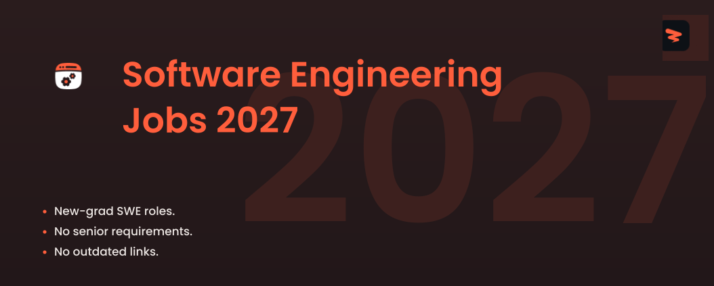

<!-- Cover -->

# Software Engineering Jobs 2027

🚀 Software engineering jobs for new graduates, updated every 10 minutes.

  
  
  
  

---

## **Website & Autofill Extension**

Explore Zapply's website and check out:

- Our Chrome extension, which autofills job applications in seconds.
- A dedicated job board featuring the latest openings across various roles.
- User accounts with multiple profiles for different resume types and roles.
- Job application tracking with streaks and commitment awards.

Experience an advanced career journey with us! 🚀

  

## Explore Around

Connect and seek advice from a growing network of fellow students and new grads.

  
  &nbsp;&nbsp;
  

---

 

<h3>💻 <strong>Software Engineering</strong></h3>

| Company | Role | Location | Posted | Visa | **Apply** |
|---------|------|----------|--------|------|----------|
| **Rocket Companies** | Software Engineer I | Detroit, MI | 1h | ✅ Sponsor |  |
| **Johnson Controls** | Software Engineering Co-Op | Burlington-Massachusetts-United... | 1h | ✅ Sponsor |  |
| **State Street** | Software Engineering Intern - Full-time Internship (Jan - June 2027) | Boston, Massachusetts | 1h | ✅ Sponsor |  |
| **State Street** | Software Engineering Intern - Full-time Internship (Jan - June 2027) | Boston, Massachusetts | 1h | ✅ Sponsor |  |
| **Boeing** | Software Engineer (Associate or Experienced) | Colorado Springs, CO | 1h | ✅ Sponsor |  |
| **Boeing** | DevSecOps Software Engineer, Phantom Works (Associate or Experienced) | Saint Charles, MO | 1h | ✅ Sponsor |  |
| **Boeing** | Software Engineer, Missile Defense National Team, C2BMC (Associate, Experienced or Senior) | Colorado Springs, CO | 1h | ✅ Sponsor |  |
| **PTC** | Creo Software Engineering Intern (Summer 2027) | Boston, MA, USA | 2h | ✅ Sponsor |  |
| **RTX** | Software Engineering Intern (Summer 2027) | IA-CEDAR RAPIDS | 3h | ✅ Sponsor |  |
| **RTX** | Software Engineer I (Onsite) | IA-CEDAR RAPIDS | 3h | ✅ Sponsor |  |
| **RTX** | Software Engineer I (Onsite) | FL-ST PETERSBURG | 3h | ✅ Sponsor |  |
| **KLA** | Software Engineering Intern | Milpitas, CA | 5h | ✅ Sponsor |  |
| **Truveta** | Winter Software Engineering Intern | Seattle, WA | 12h | ✅ Sponsor |  |
| **Boston Scientific** | Urology R&D Software Engineering Co-op | United States  US-MN-Maple Grove | 12h |  |  |
| **Western Digital** | Spring 2027 Intern - Software Engineering | Irvine, CA | 16h | ✅ Sponsor |  |
| **Booz Allen Hamilton** | University, 2027 Summer Games Software Developer Intern - McLean, VA | McLean, VA | 17h | ✅ Sponsor |  |
| **Mytra** | Software Engineer Intern | Brisbane, CA | Date unknown |  |  |
| **Zillow** | Software Development Engineer - Intern | Seattle-WA | 1d | ✅ Sponsor |  |
| **CACI** | Early Career NASA Space Reactor – 1 Freedom Flight Software Development Engineer | Houston, TX, US | 1d | ✅ Sponsor |  |
| **Bose** | Software Engineer Co-op | US, MA - Framingham | 1d | ✅ Sponsor |  |
| **Sierra Nevada Corporation** | Software Engineer I | Lone Tree, CO | 1d |  |  |
| **Copart** | Software Engineering Intern | Dallas, TX - Headquarters | 1d | ✅ Sponsor |  |
| **Copart** | Software Engineering Intern | Dallas, TX - Headquarters | 1d | ✅ Sponsor |  |
| **Analog Devices** | Embedded Software Engineer Intern | US, TX, Austin, Plaza on the Lake | 1d | ✅ Sponsor |  |
| **Nelnet** | Intern - IT Software Engineer (Summer 2027) | Lincoln, NE | 1d | ✅ Sponsor |  |
| **State Street** | Software Engineering Intern - Full-time Internship (Jan - June 2027) | Quincy, Massachusetts | 1d | ✅ Sponsor |  |
| **Micron Technology** | New College Grad - Software Engineer | Boise, ID - Main Site | 1d | ✅ Sponsor |  |
| **Airbnb** | Software Engineering Intern (BS/MS) | San Francisco, California | 1d | ✅ Sponsor |  |
| **BMO** | Software Developer (New or Recent Graduate) | Berkeley Heights, NJ, USA | 1d | ✅ Sponsor |  |
| **Twitch** | Software Engineer I, Commerce | Seattle, WA | 1d | ✅ Sponsor |  |
| **BAE Systems** | Software Engineer I - Applied Visualization and Interaction | Broomfield, Colorado | 1d |  |  |
| **Relativity Space** | Software Engineer I (Factory Platform) | Long Beach, California, United... | 1d | ✅ Sponsor |  |
| **Leidos** | Software Engineer TS/SCI w Poly (Junior to Senior Levels) | San Diego, CA | 1d | ✅ Sponsor |  |
| **Leidos** | Software Engineer TS/SCI w Poly(Junior-Senior Levels)) | Aurora, CO | 1d | ✅ Sponsor |  |
| **Crusoe** | Software Engineering Intern, Summer 2027 | San Francisco, CA - US | 1d | ✅ Sponsor |  |
| **Motorola Solutions** | Software Engineer Co-op | Utah Remote Work | 2d | ✅ Sponsor |  |
| **Draper** | Software Engineering & DevOps Intern | Cambridge, MA | 2d |  |  |
| **AeroVironment** | Junior Software Engineer (TS/SCI w/ Poly) | 420 National Business Parkway,... | 2d |  |  |
| **CACI** | Software Engineering Intern - Summer 2027 | Sarasota, FL, US | 2d | ✅ Sponsor |  |
| **Aerospace Corporation** | 2027 Embedded Software Engineering Undergrad Intern | El Segundo, CA | 2d |  |  |
| **Salesforce** | Software Engineering, AI Systems PMTS | California San Francisco | 2d | ✅ Sponsor |  |
| **Cox** | Entry Level Software Engineer - Atlanta, GA | Atlanta GA | 2d | ✅ Sponsor |  |
| **T-Mobile** | Summer 2027 Software Engineering AI Intern | Atlanta, Georgia | 2d | ✅ Sponsor |  |
| **T-Mobile** | Summer 2027 Software Engineering Intern | Overland Park Kansas | 2d | ✅ Sponsor |  |
| **T-Mobile** | Summer 2027 Software Engineer Internship | Overland Park, Kansas | 2d | ✅ Sponsor |  |
| **Symbotic** | Intern- Software Engineer | USA Wilmington,  MA - | 2d | ✅ Sponsor |  |
| **Aerospace Corporation** | 2027 Software Engineering Grad Intern | Chantilly, VA | 2d |  |  |
| **Bread Financial** | Intern - Software Engineering | Columbus, OH | 2d |  |  |
| **Amentum** | Entry Level Software Engineer - SECRET | VA-Dahlgren | 2d |  |  |
| **Micron** | New College Grad - Software Engineer | Boise, Idaho, United States of... | 2d |  |  |
| **Emerson Electric** | Software Engineering Intern | Austin, TX, United States | 2d | ✅ Sponsor |  |
| **General Atomics** | Intern - Software Engineer | Charlottesville, Virginia | 2d |  |  |
| **General Atomics** | Intern - Software Engineer | Tyngsborough, Massachusetts | 2d |  |  |
| **GM Financial** | Intern - Software Development Engineer | Arlington, TX, United States | 2d |  |  |
| **Schweitzer Engineering Laboratories** | Software Engineer Intern | Washington - Pullman | Date unknown | ✅ Sponsor |  |
| **Northrop Grumman** | 2027 Cyber Software Engineer Intern - San Antonio TX | United States-Texas-San Antonio | 2d |  |  |
| **JLL** | Specialist, Mobile Engineering Services | Jacksonville, FL | 2d | ✅ Sponsor |  |
| **Motorola Solutions** | 2026 Software Engineering Co-Op | Plantation, FL | 2d | ✅ Sponsor |  |
| **AeroVironment** | Software Engineer (EMB) I | 14501 Princeton Moorpark, CA | 3d |  |  |
| **AeroVironment** | Software Engineer (EMB), I | 14501 Princeton Moorpark, CA | 3d |  |  |
| **Aerospace Corporation** | 2027 Software Engineering Grad Intern | El Segundo, CA | 3d |  |  |
| **Analog Devices** | Software Engineering Intern (Medical Device & Healthcare Integration) | US, MA, Wilmington | 3d | ✅ Sponsor |  |
| **Viavi Solutions** | Software Engineering Co-op | Germantown, MD USA | 3d | ✅ Sponsor |  |
| **GM Financial** | Intern - Software Development Engineer | Irving, TX, United States | 3d |  |  |
| **PTC** | Onshape Software Engineer Intern (Summer 2027) | Boston, MA, USA | 4d | ✅ Sponsor |  |
| **BAE Systems** | Software Engineer I | Nashua, New Hampshire | 4d |  |  |
| **Nightwing** | Junior Software Engineer  (SWE0) | Annapolis Junction, MD | 5d |  |  |
| **Symbotic** | Co-op - Software Engineer | USA Wilmington,  MA - | 5d | ✅ Sponsor |  |
| **The Travelers Companies** | Software Engineer I (TypeScript, React, AWS, AI-Assisted Development) | CT - Hartford | 5d |  |  |
| **Cisco** | Software Engineer Compiler I (Full Time) – United States | Austin Texas US | 5d | ✅ Sponsor |  |
| **Twitch** | Software Engineer I, Payments | San Francisco, CA | 5d | ✅ Sponsor |  |
| **Applied Materials** | Summer 2027 Software Engineer Intern- Bachelor's/Master's (Santa Clara, CA) | Santa Clara,CA | 5d | ✅ Sponsor |  |
| **Sierra Nevada Corporation** | Software Engineer I | Lone Tree, CO | 6d |  |  |
| **CME Group** | Software Engineering Fellowship - Summer 2027 | Chicago | 6d |  |  |
| **Booz Allen Hamilton** | C++ Software Engineer, Junior | Beavercreek, OH | 6d | ✅ Sponsor |  |
| **Leidos** | Junior Software Engineer / Data Scientist Intern | Tucson, AZ | 6d | ✅ Sponsor |  |
| **General Atomics** | Intern - Software Engineer | Herndon, Virginia | 6d |  |  |
| **Cisco** | Software Engineer Compiler I (Full Time) – United States | Austin, Texas | 6d | ✅ Sponsor |  |
| **BAE Systems** | Software Engineering Intern IV, (Summer 2027) Onsite | Nashua, New Hampshire | 6d |  |  |
| **Affirm** | Software Engineer I, Backend (Continuous Delivery) | Remote US | 6d | ✅ Sponsor |  |
| **Muon Space** | Software Engineering Intern-Information Systems (Summer 2027) | San Jose, CA | 6d |  |  |
| **Vital Lyfe** | Software Engineering Internship - Summer 2027 | Los Angeles - Greater Area | 6d |  |  |
| **Cigna** | The Cigna Group's Technology Development Program  - Software Engineering Track Summer Internship | St Louis, MO | 6d | ✅ Sponsor |  |
| **Entegris** | Embedded Software Engineering Intern | Bloomington, MN | 6d | ✅ Sponsor |  |
| **Ancestry** | Software Engineer – Observability, Co-op | Draper, Utah | 1w |  |  |
| **HPE** | Systems/Software Engineer I | Sunnyvale, California, United... | 1w | ✅ Sponsor |  |
| **HPE (University)** | Systems/Software Engineer I | Sunnyvale, California, United... | 1w | ✅ Sponsor |  |
| **CACI** | Embedded Software Development Intern - Summer 2027 | Denver, CO, US | 1w | ✅ Sponsor |  |
| **Rockwell Automation** | Intern, Software Developer/Engineering | Mequon, Wisconsin, United States | 1w | ✅ Sponsor |  |
| **Symbotic** | New Grad- Robotics Software Engineer | USA Wilmington,  MA - | 1w | ✅ Sponsor |  |
| **NBCUniversal** | Software Engineering Internships – Summer 2027 | Universal City, CA | 1w | ✅ Sponsor |  |
| **Twitch** | Software Engineer I, Commerce | San Francisco, CA | 1w | ✅ Sponsor |  |
| **Cox** | Software Engineering Intern - Summer 2027 (Atlanta, GA) | Atlanta GA | 1w | ✅ Sponsor |  |
| **Brex** | Software Engineer, Intern  (Summer 2027) | San Francisco, California,... | 1w | ✅ Sponsor |  |
| **Motorola Solutions** | Software Engineering Intern - 2027 Summer Internship | Schaumburg, IL | 1w | ✅ Sponsor |  |
| **Bose** | Digital Signal Processing ML Software Development Co-op | US, MA - Framingham | 1w | ✅ Sponsor |  |
| **Salesforce** | Software Engineering AMTS (College Grad) | California San Francisco | 1w | ✅ Sponsor |  |
| **Caterpillar** | Embedded Software Engineering Specialist - Agentic IDE | Mossville, Illinois | 1w | ✅ Sponsor |  |
| **Thomson Reuters** | Software Engineer Co-Op | Rochester New York | 1w | ✅ Sponsor |  |
| **Cisco** | Software Engineer Embedded Systems I (Intern) - United States | San Jose California US | 1w | ✅ Sponsor |  |

Apply for more jobs at

<h3>🤖 <strong>AI / ML Engineering</strong></h3>

| Company | Role | Location | Posted | Visa | **Apply** |
|---------|------|----------|--------|------|----------|
| **State Street** | AI Engineering Intern - Full-time Internship (Jan - June 2027) | Cambridge, Massachusetts | 1h | ✅ Sponsor |  |
| **Samsung Semiconductor** | Intern, Architecture Research Engineer (Resilient Collective Communications) | San Jose, California, United States | 10h | ✅ Sponsor |  |
| **Samsung Semiconductor** | Intern, Architecture Research Engineer (Agentic AI Workload Characterization) | San Jose, California, United States | 10h | ✅ Sponsor |  |
| **Crest Industries** | Data Engineer I | Ruston, Louisiana | 12h |  |  |
| **Samsung Semiconductor** | Intern, Architecture Research Engineer (MoE Placement for Serving at Scale) | San Jose, California, United States | 13h | ✅ Sponsor |  |
| **National Interstate Insurance** | Data Engineer Developer Intern – Summer 2027 | Cincinnati, OH | 1d |  |  |
| **State Street** | State Street Investment Management - Data Scientist - Summer Internship 2027 | Boston, Massachusetts | 1d | ✅ Sponsor |  |
| **University of Texas at Austin** | Research Engineering/Scientist Associate I | UT MAIN | 2d |  |  |
| **T-Mobile** | Summer 2027 AI Engineering Internship | Bellevue, Washington | 2d | ✅ Sponsor |  |
| **Intuitive** | Clinical Research Engineering Intern | Sunnyvale, CA | 2d | ✅ Sponsor |  |
| **Booz Allen Hamilton** | Scientific Data Engineering Specialist | McLean, VA | 2d | ✅ Sponsor |  |
| **Boston Scientific** | AI Engineering Intern (Generative & Agentic AI) | Marlborough US-MA, United... | 2d |  |  |
| **CACI** | Data Engineering/Analytics Support | Norco, CA, US | 3d | ✅ Sponsor |  |
| **NREL** | Graduate Internship (Year-Round) - Geospatial Data Science Modeling and Analysis | Golden, CO | 3d | ✅ Sponsor |  |
| **Carnegie Mellon SEI** | Cyber AI Engineering Intern (Spring 2027) | Pittsburgh, PA | 5d |  |  |
| **Micron Technology** | Intern -  AI Engineer Platform | Boise, ID - Main Site | 5d | ✅ Sponsor |  |
| **University of Texas at Austin** | Research Engineering/Scientist Associate I | UT MAIN | 6d |  |  |
| **Carnegie Mellon University** | Cyber AI Engineering Intern (Spring 2027) | Pittsburgh, PA | 6d | ✅ Sponsor |  |
| **BAE Systems** | Data Engineer_ SPLUNK | Sterling, Virginia | 6d |  |  |
| **Entegris** | Data Engineering Intern - Summer 2027 | Aurora, IL | 6d | ✅ Sponsor |  |
| **ServiceNow** | Assoc AI Engineering (Cloud Security Automation) Intern | Santa Clara, CALIFORNIA | 1w | ✅ Sponsor |  |
| **Riot Games** | Machine Learning Engineering Intern (Masters/PhD) - Summer 2027 | Los Angeles, USA | 1w | ✅ Sponsor |  |
| **Riot Games** | Data Engineering Intern - Summer 2027 | Los Angeles, USA | 1w | ✅ Sponsor |  |
| **University of Texas at Austin** | Research Engineering/ Scientist Associate I (4216) | MARINE SCIENCE INSTITUTE | 1w |  |  |
| **Morgan Stanley** | Assistant Vice President, Data Science & Analysis | Jersey City, New Jersey, United... | 1w | ✅ Sponsor |  |
| **BAE Systems** | Data Scientist_ SPLUNK | Sterling, Virginia | 1w |  |  |
| **BAE Systems** | Research Engineering Intern IV, Summer 2027 (Onsite) | Merrimack, New Hampshire | 1w |  |  |
| **Thales** | AI Engineer - Graduate | Orlando | 1w |  |  |
| **T-Mobile** | Summer 2027 Data Engineering Internship | Frisco Texas | 1w | ✅ Sponsor |  |
| **T-Mobile** | Summer 2027 Data Engineering Internship | Frisco Texas | 1w | ✅ Sponsor |  |
| **NVIDIA** | PhD Research Scientist, Fundamental Generative AI - New College Grad 2026 | US, CA, Santa Clara | 1w | ✅ Sponsor |  |
| **NVIDIA** | Research Scientist, AI and Systems Security - PhD New College Grad 2026 | MA Westford | 1w | ✅ Sponsor |  |
| **General Motors** | R&D Researcher – AI and Machine Learning | Warren, Michigan, United States... | 1w | ✅ Sponsor |  |
| **ICD** | Summer 2027 AI/ML Engineering Internship | Jersey City, NJ, United States | 1w |  |  |
| **Tradeweb** | Summer 2027 AI/ML Engineering Internship | Jersey City, NJ, United States | 1w |  |  |
| **Parsons** | AI/ML Engineering Intern Summer 2027 | VA, Centreville, R188194 | Date unknown |  |  |
| **Bose** | DSP/ML Research Engineer Intern   Summer 2027 | US, MA - Framingham | 2w | ✅ Sponsor |  |
| **Bose** | DSP/ML Research Engineer Co-op   Spring 2027 | US, MA - Framingham | 2w | ✅ Sponsor |  |
| **Etched** | IA Research Engineer Intern | San Jose | 2w | ✅ Sponsor |  |
| **Bose** | Software/DSP Research Engineer Co-op | US, MA - Framingham | 2w | ✅ Sponsor |  |
| **Booz Allen Hamilton** | University - 2027 Summer Games Data Scientist Intern - Royal Oak, MI | Detroit, MI | 2w | ✅ Sponsor |  |
| **MITRE** | Data Science and Engineering Intern | McLean, Virginia | 2w |  |  |
| **Booz Allen Hamilton** | University - 2027 Summer Games Data Scientist Intern - Annapolis Junction, MD | Annapolis Junction, MD | 3w | ✅ Sponsor |  |
| **Mercor** | Research Engineer, Intern – Benchmarking | San Francisco | 3w |  |  |
| **Mercor** | Research Engineer Intern - Environments, Data and Post-Training | San Francisco | 3w |  |  |
| **National Interstate Insurance** | Data Engineering Intern – Summer 2027 | Cincinnati, OH | 3w |  |  |
| **Sony** | Research Engineer Intern (Ethical Creative and Protective AI Lab) | New York | 3w |  |  |
| **Saviynt** | Research Scientist Intern - PhD | Milpitas, California | 3w | ✅ Sponsor |  |
| **ByteDance** | Data Lake Infrastructure & Data Analytics Research Engineer Intern (AML-Ark-US) - 2027 Summer | San Jose, California | Date unknown | ✅ Sponsor |  |
| **ByteDance** | Data Lake Infrastructure & Data Analytics Research Engineer Intern (AML-Ark-US) - 2027 Summer | Seattle, Washington | Date unknown | ✅ Sponsor |  |
| **Amperesand** | AI/ML Engineering Intern | Sunnyvale, California, United... | 3w | ✅ Sponsor |  |
| **Rivian and Volkswagen Group Technologies** | Data Engineering Intern - AI & Analytics (Summer 2027) | Palo Alto, California | 3w | ✅ Sponsor |  |
| **MITRE** | AI Engineering Intern | Bedford, Massachusetts | 4w |  |  |
| **Nissan** | Financial AI Engineering Intern - Summer 2027 - Franklin, TN | Franklin, Tennessee - United... | 1mo |  |  |
| **AspenTech** | Data Science Intern - Summer 2027 - Bedford, MA | Bedford, Massachusetts | 1mo | ✅ Sponsor |  |
| **Intel** | Software Research Engineering - (PhD Intern) | US, Oregon, Hillsboro | 1mo | ✅ Sponsor |  |
| **Intel** | System Technology Research Engineer - (PhD Intern) | Oregon Hillsboro | 1mo | ✅ Sponsor |  |
| **AeroVironment** | Machine Learning Engineering Intern | Centreville, VA | 1mo |  |  |
| **Crowe** | Machine Learning Intern | Chicago, IL | 1mo |  |  |
| **Moderna** | Co-Op, Research Engineering and AI Integration | Cambridge, Massachusetts, Research | 1mo |  |  |
| **Campbell Soup Company** | Data Engineer – Agentic AI & ML Ops (Co-op) | USA - NJ - Camden | 1mo |  |  |
| **Plexus** | Intern - IT Data Science (Summer 2027) | Neenah, WI | 1mo |  |  |
| **Capital One** | Current PhD, AI Engineering Internship Program - Summer 2027 | New York, NY | 1mo | ✅ Sponsor |  |
| **Capital One** | Current Master's, AI Engineering Internship Program - Summer 2027 | New York, NY | 1mo | ✅ Sponsor |  |
| **Anduril** | Winter 2027 Research Engineer Co-op | Santa Ana, California, United... | 1mo |  |  |
| **Marmon Holdings** | Data Engineering Intern OR Student Co-Op | Milwaukee, WI | 1mo |  |  |
| **IMC Trading** | Machine Learning Engineer Intern - Summer 2027 | New York, United States | 1mo | ✅ Sponsor |  |
| **First Solar** | Data Engineering Intern (Spring 2027) | Perrysburg, OH, United States | 1mo | ✅ Sponsor |  |
| **IMC Trading** | Hardware Machine Learning PhD Research Internship | Chicago, United States | 1mo | ✅ Sponsor |  |
| **Qualcomm** | Machine Learning & Artificial Intelligence Engineering Internship – Summer 2027 | San Diego, CA | 2026-09-18 | ✅ Sponsor |  |
| **Gecko Robotics** | AI/Machine Learning Engineering Intern | New York City | 2026-09-16 | ✅ Sponsor |  |
| **DV Trading** | AI Engineer Intern - Summer 2027 | Chicago | 2026-09-09 |  |  |
| **Rivian and Volkswagen Group Technologies** | Data Engineering Intern - AI & Analytics (January - August 2027) | Palo Alto, California | 2026-09-08 | ✅ Sponsor |  |
| **Solidigm** | 2027 Graduate Software, Firmware & AI Engineering Internships - US | Rancho Cordova, CA | 2026-09-05 |  |  |
| **Applied Intuition** | Research Engineer - New Grad (2027) | Sunnyvale | 2026-08-14 | ✅ Sponsor |  |
| **The Nuclear Company** | Summer 2027 Data Science Intern | Washington, DC | 2026-08-07 |  |  |
| **The Nuclear Company** | Summer 2027 AI/ML Engineering Intern | Washington, DC | 2026-08-07 |  |  |
| **The Nuclear Company** | Spring 2027 Data Science Intern | Washington, DC | 2026-08-07 |  |  |
| **Yotta Labs** | Research Engineer Intern - AI Systems | United States | 2026-08-02 | ✅ Sponsor |  |
| **Jump Trading** | Campus AI Research Engineer – Research Automation (Intern) | Chicago | 2026-07-08 | ✅ Sponsor |  |
| **Jump Trading** | Campus AI Research Engineer - Deep Learning (Intern) | Chicago | 2026-07-08 | ✅ Sponsor |  |
| **Jump Trading** | Campus AI Research Engineer (Intern) | Chicago | 2026-07-08 | ✅ Sponsor |  |
| **Human Computer Lab** | Intern - Software/ML Engineer | San Francisco | 2026-04-03 |  |  |
| **Octaura** | Intern, Data Engineering | New York | 2025-03-04 |  |  |

Apply for more jobs at

<h3>🔒 <strong>Infrastructure & Security</strong></h3>

| Company | Role | Location | Posted | Visa | **Apply** |
|---------|------|----------|--------|------|----------|
| **Trimble** | QA Engineer Intern | NH, Portsmouth | 1h | ✅ Sponsor |  |
| **State Street** | AI Security & Cybersecurity, Technology Intern - Full-time Internship (Jan -June 2027) | Austin Texas | 1h | ✅ Sponsor |  |
| **Boeing** | Site Reliability Engineer (Associate, Experienced, or Senior) | USA - Berkeley, MO | 1h | ✅ Sponsor |  |
| **Boeing** | Site Reliability Engineer (Associate, Experienced, or Senior) | USA - Berkeley, MO | 1h | ✅ Sponsor |  |
| **Bread Financial** | Intern - Cybersecurity | Columbus, OH | 2h |  |  |
| **Aerospace Corporation** | 2027 Cloud Solutions Engineer / Site Reliability Grad Intern | El Segundo, CA | 1d |  |  |
| **Amentum** | DoD SkillBridge Internship - Cybersecurity Software and Systems Engineer | TX-Houston | 1d |  |  |
| **Amazon.com Services LLC** | Security Engineer I, Security Incident Response Team (SIRT) | Arlington, VA | 1d | ✅ Sponsor |  |
| **Marvell** | AI Infrastructure Engineer Intern, MS - Summer 2027 | Santa Clara, CA | 2d | ✅ Sponsor |  |
| **CACI** | Cybersecurity Intern - Summer 2027 | Any State | 2d | ✅ Sponsor |  |
| **Amentum** | Cybersecurity Engineer Junior | FL-Cocoa Beach | 2d |  |  |
| **RTX** | Embedded Cybersecurity Researcher - Onsite | IA-CEDAR RAPIDS | 2d | ✅ Sponsor |  |
| **LinkedIn** | Systems & Infrastructure Engineer Intern, Masters - Summer 2027 (Mountain View, CA) | Mountain View, CA | 2d | ✅ Sponsor |  |
| **Pacific Fusion** | Summer 2027 HPC/DevOps Engineering Intern | San Leandro, CA | 2d |  |  |
| **Leidos** | Cybersecurity Intern | Fort Belvoir, VA | 2d | ✅ Sponsor |  |
| **Leidos** | Network Vulnerability Remediation Engineer – Junior Level | 6314 Remote/Teleworker US | 2d |  |  |
| **Zoetis** | Information Security Intern | Parsippany | 3d | ✅ Sponsor |  |
| **GlobalFoundries** | Test Wafer and Qual Automation Engineering (Summer 2027) | USA - Vermont - Essex Junction | 3d | ✅ Sponsor |  |
| **Fiserv** | 2027 Technology Internship Program - Cybersecurity (Columbus, OH) | Columbus, Ohio | 3d | ✅ Sponsor |  |
| **Fiserv** | 2027 Technology Internship Program - Cybersecurity (Berkeley Heights, NJ) | Berkeley Heights, New Jersey | 3d | ✅ Sponsor |  |
| **Aerospace Corporation** | 2027 Hardware Security Engineering Grad Intern | El Segundo, CA | 3d |  |  |
| **Aerospace Corporation** | 2027 Hardware Security Engineering Undergrad  Intern | El Segundo, CA | 3d |  |  |
| **Thermo Fisher Scientific** | Executive Assistant - Cybersecurity & Infrastructure | Frederick, Maryland, USA | 3d | ✅ Sponsor |  |
| **JPMorgan Chase** | Product Delivery Manager – Infrastructure Engineering Enablement | Columbus, OH, United States | 3d | ✅ Sponsor |  |
| **Carnegie Mellon SEI** | Cybersecurity Engineer Intern (Spring 2027) | Pittsburgh, PA | 5d |  |  |
| **Bloom Energy** | Automation Engineering Intern | Fremont, California | 5d | ✅ Sponsor |  |
| **Amazon Data Services, Inc.** | Data Center Infrastructure Engineer Intern, Summer 2027 - East | Herndon, VA | 5d | ✅ Sponsor |  |
| **Amazon Data Services, Inc.** | Data Center Infrastructure Engineer Intern, Summer 2027 - West Coast | Umatilla, OR | 5d | ✅ Sponsor |  |
| **ServiceNow** | Security Engineer Intern | Kirkland, Washington | 5d | ✅ Sponsor |  |
| **ServiceNow** | Information Security Analyst Intern | San Diego, CALIFORNIA | 5d | ✅ Sponsor |  |
| **ServiceNow** | AI Security Engineer Intern | San Diego, California | 5d | ✅ Sponsor |  |
| **CoStar Group** | Security Engineer Intern - Richmond, VA | VA Richmond | 6d |  |  |
| **Carnegie Mellon University** | Cybersecurity Engineer Intern (Spring 2027) | Pittsburgh, PA | 6d | ✅ Sponsor |  |
| **Booz Allen Hamilton** | Cybersecurity Test Engineer, Junior | Rome, NY | 6d | ✅ Sponsor |  |
| **RTX** | Embedded Software Security Engineer I - S3E | AZ-TUCSON | 6d | ✅ Sponsor |  |
| **BAE Systems** | Network Engineer_Network Ops Center | Sterling, Virginia | 6d |  |  |
| **Muon Space** | Security Engineering Intern (Summer 2027) | Mountain View, CA | 6d |  |  |
| **Cboe** | DevOps Intern | Overland Park OPX | 1w | ✅ Sponsor |  |
| **Atlantic Health System** | Cybersecurity Engineer I | Morristown, NJ, United States | 1w |  |  |
| **Sedaro** | DevOps Intern | Arlington, Virginia | Date unknown |  |  |
| **Grant Thornton** | Cybersecurity and Privacy Intern - Summer 2027 | New York, NY, United States | 1w | ✅ Sponsor |  |
| **BAE Systems** | Network Engineer_Voice & Video | Sterling, Virginia | 1w |  |  |
| **T-Mobile** | Summer 2027 Site Reliability Engineering Internship | Frisco Texas | 1w | ✅ Sponsor |  |
| **ByteDance** | Site Reliability Engineer - Intern (Data Platform, Computer Platform) - 2027 Start | San Jose, California | Date unknown | ✅ Sponsor |  |
| **Anduril** | 2027 New Grad Information Security Engineer | Costa Mesa, California, United... | 1w |  |  |
| **HP Inc** | Cloud Engineering Intern - HP IQ | San Francisco, California,... | 1w | ✅ Sponsor |  |
| **Northrop Grumman** | 2027 Software Testing Engineering Intern - Apopka FL | United States-Florida-Apopka | 1w |  |  |
| **Illumio** | Engineering Intern, SRE | Sunnyvale, California - | 1w | ✅ Sponsor |  |
| **CACI** | Cyber Security Intern - Summer 2027 | Sterling, VA, US | 1w | ✅ Sponsor |  |
| **Lila Sciences** | Co-Op, IT/OT Security Analyst | Cambridge, MA USA | 1w | ✅ Sponsor |  |
| **RTX** | Battlespace Cybersecurity Researcher | IA-CEDAR RAPIDS | 1w | ✅ Sponsor |  |
| **NBCUniversal** | Media Tech: Cybersecurity, Governance & Security Engineering Internships – Summer 2027 | New York, NY | 1w | ✅ Sponsor |  |
| **Apple** | Tools & Automation Engineer — Early Career | Sunnyvale | 1w | ✅ Sponsor |  |
| **Johnson & Johnson** | Software Test Engineering Co-op (RLM) | Danvers, Massachusetts, United... | 1w | ✅ Sponsor |  |
| **Vanguard** | Cloud Security Penetration Tester | DallasFt Worth, TX | 1w | ✅ Sponsor |  |
| **JLL** | Automation Engineering Apprentice | Niagara Falls, NY | 1w | ✅ Sponsor |  |
| **Varda Space** | Site Reliability Internship - Summer 2027 | El Segundo, California, United... | 1w |  |  |
| **Booz Allen Hamilton** | Information Security Risk Specialist | Patuxent River, MD | 1w | ✅ Sponsor |  |
| **John Deere** | Part-Time Student - Test Automation Engineering - Silvis, IL | Silvis, IL,Illinois,United States | 1w |  |  |
| **Federal Reserve System** | 2027 Summer Internship Program - Information Security Intern | Atlanta, GA | 1w |  |  |
| **Mastercard** | Site Reliability Engineer I | O'Fallon, Missouri | 1w | ✅ Sponsor |  |
| **Boeing** | DevOps Developer (Associate or Experienced or Lead) | Seal Beach, CA | 1w | ✅ Sponsor |  |
| **Etched** | Infrastructure Engineering & Projects Intern | San Jose | 1w | ✅ Sponsor |  |
| **ASML** | Internship - Application Software QA Engineer | San Jose, CA, USA | 2w | ✅ Sponsor |  |
| **Northrop Grumman** | 2027 Software Test Engineering Intern - Roy UT | United States-Utah-Roy | 2w |  |  |
| **LLNL** | Cybersecurity Undergraduate Intern - Cyber and Critical Infrastructure Summer Institute - Summer... | Livermore, CA | 2w | ✅ Sponsor |  |
| **LLNL** | Cybersecurity Graduate Intern - Cyber and Critical Infrastructure Summer Institute - Summer 2027 | Livermore, CA | 2w | ✅ Sponsor |  |
| **GM Financial** | Intern - Cloud Engineer | Irving, TX, United States | 2w |  |  |
| **ICD** | Summer 2027 Cyber Security Internship | New York, NY, United States | 2w |  |  |
| **Tradeweb** | Summer 2027 Cyber Security Internship | New York, NY, United States | 2w |  |  |
| **BAE Systems** | Network Engineer_Network Serices | Sterling, Virginia | 2w |  |  |
| **Sierra Nevada Corporation** | DevOps Engineer Intern (Summer 2027) | Southern Pines, NC | 2w |  |  |
| **Cisco** | Software QA Engineer I (Full Time) - United States | Richardson, Texas | 2w | ✅ Sponsor |  |
| **GardaWorld** | Infrastructure Engineer Intern | Wayzata, Minnesota, United States | 2w |  |  |
| **Schweitzer Engineering Laboratories** | Automation Engineering Intern | Idaho - Moscow | Date unknown | ✅ Sponsor |  |
| **Booz Allen Hamilton** | University - 2027 Summer Games Cyber Security Intern - Lexington, MA | Lexington, MA | 2w | ✅ Sponsor |  |
| **Northrop Grumman** | 2027 Software Test Engineering Intern- Roy UT | United States-Utah-Roy | 2w |  |  |
| **National Interstate Insurance** | DevOps Developer Intern - Summer 2027 | Cincinnati, OH | 3w |  |  |
| **HP Inc** | Software Product Security Intern - HP IQ | San Francisco, California,... | 3w | ✅ Sponsor |  |
| **HP Inc** | Software Quality Assurance Intern | San Francisco, California,... | 3w | ✅ Sponsor |  |
| **Leidos** | Cybersecurity Engineer Co-op | Bethesda, MD | 3w | ✅ Sponsor |  |
| **Figma** | PhD Intern, Security Engineer (2027) | San Francisco, CA • New York, NY | 3w | ✅ Sponsor |  |
| **The Nuclear Company** | Spring 2027 Security Engineer Intern | Washington, DC | 3w |  |  |
| **Visa** | Network and Security Engineering Intern - 2027, Highlands Ranch, CO | Denver, CO | 3w | ✅ Sponsor |  |
| **ABB** | Automation Engineer Intern - Summer 2027 | New Berlin, Wisconsin, United... | 3w | ✅ Sponsor |  |
| **ABB** | Automation Engineer Intern - Summer 2027 | New Berlin, Wisconsin, United... | 3w | ✅ Sponsor |  |
| **Visa** | Network and Security Engineering Intern - 2027, Ashburn, VA | Ashburn, VA | 3w | ✅ Sponsor |  |
| **Jabil** | Automation Engineering Intern | Clinton, MA | 3w | ✅ Sponsor |  |
| **Wells Fargo** | 2027 Technology Summer Internship - Early Careers (Cybersecurity) | CHARLOTTE, NC | 3w | ✅ Sponsor |  |
| **Boston Properties** | Cyber Security Co-Op | Boston, MA, United States | 3w |  |  |
| **Cox** | Cybersecurity Intern - Summer 2027 | Atlanta GA | 3w | ✅ Sponsor |  |
| **Analog Devices** | DevOps Co-Op | US, MA, Boston | 3w | ✅ Sponsor |  |
| **Impulse Space** | Information Security Intern (Summer 2027) | Redondo Beach, California | Date unknown |  |  |
| **ByteDance** | Site Reliability Engineer Intern (Data Infra) - 2027 Summer | Seattle, Washington | Date unknown | ✅ Sponsor |  |
| **ByteDance** | Production System Engineer Project Intern (Server DevOps) - 2027 Start | New York, New York | Date unknown | ✅ Sponsor |  |
| **ASML** | Internship - Software Quality Assurance | San Jose, CA, USA | 3w | ✅ Sponsor |  |
| **ASML** | Internship - Software Quality Assurance | San Jose, CA, USA | 3w | ✅ Sponsor |  |
| **HPE (University)** | Cybersecurity Engineering Intern | Spring, Texas, United States of... | 3w | ✅ Sponsor |  |
| **Nissan** | Cyber Security Intern - Summer 2027 - Smyrna, TN | Smyrna, Tennessee - United... | 4w |  |  |
| **Intel** | Information Security Engineer Undergraduate Intern | US, California, Folsom | 4w | ✅ Sponsor |  |

Apply for more jobs at

<h3>⚙️ <strong>Systems & Embedded</strong></h3>

| Company | Role | Location | Posted | Visa | **Apply** |
|---------|------|----------|--------|------|----------|
| **Boeing** | Software Systems Engineer (Associate or Experienced) | USA - Colorado Springs, CO | 1h | ✅ Sponsor |  |
| **Eversource Energy** | 2027 Gas Systems Engineering Co-op | MA Westborough Technology Dr | 1d | ✅ Sponsor |  |
| **UPS** | Buildings and Systems Engineering Specialist (BaSE) | WEST CHESTER, Pennsylvania | 1d | ✅ Sponsor |  |
| **Sierra Nevada Corporation** | Systems Engineering Intern (Summer 2027) | Plano, TX | 2d |  |  |
| **Thorlabs** | Photonics Systems Engineer I | Newton, New Jersey | 2d |  |  |
| **Texas Instruments** | Systems Engineering Intern - Power | Dallas, TX, United States | 2d | ✅ Sponsor |  |
| **Pacific Fusion** | Summer 2027 Vacuum Systems Engineering Internship | San Leandro, CA | 2d |  |  |
| **Impulse Space** | Digital Signal Processing Graduate Engineering Internship (Summer 2027) | Redondo Beach, California | Date unknown |  |  |
| **Impulse Space** | Digital Design (FPGA/ASIC) Engineering Internship (Summer 2027) | Redondo Beach, California | Date unknown |  |  |
| **Carrier Global** | Systems Engineering Intern - Summer | CAI23: Carrier-Indianapolis,... | 3d |  |  |
| **AeroVironment** | Systems Engineer I | Petaluma, CA | 3d |  |  |
| **CACI** | Junior Systems Engineer | King George, VA, US | 3d | ✅ Sponsor |  |
| **Caterpillar** | Autonomy Systems Engineering Specialist | East Peoria Illinois | 3d | ✅ Sponsor |  |
| **General Atomics** | Intern - Systems Engineer | Englewood, Colorado | 3d |  |  |
| **GE Aerospace** | Digital Systems Engineering Intern - Bohemia, NY - Summer 2027 | Bohemia | 5d | ✅ Sponsor |  |
| **UPS** | Buildings and Systems Engineering Union Specialist | RIVERSIDE, California | 5d |  |  |
| **Samsung Semiconductor** | Intern, ML Compiler (Kernel Auto-Tuning) | San Jose, California, United States | 5d | ✅ Sponsor |  |
| **Sierra Nevada Corporation** | Systems Engineer Intern | Southern Pines, NC | 6d |  |  |
| **Boeing** | Software Systems Engineer (Associate or Experienced) | USA - Seal Beach, CA | 6d | ✅ Sponsor |  |
| **General Atomics** | Intern - Systems Engineer | Herndon, Virginia | 6d |  |  |
| **Motorola Solutions** | North America (NA) Systems Engineering Operations Internship  - 2027 | Chicago, IL, More... | 6d | ✅ Sponsor |  |
| **Nuro** | Systems Engineering, New Grad 2027 | Mountain View, California ( | 6d | ✅ Sponsor |  |
| **Bloom Energy** | RMCC Systems Engineering Intern | San Jose, California | 1w | ✅ Sponsor |  |
| **General Atomics** | Intern -  Aerospace Systems Engineering | Huntsville, Alabama | 1w |  |  |
| **UPS** | Buildings and Systems Engineering Specialist | PHILADELPHIA, Pennsylvania | 1w |  |  |
| **Philips** | Intern –Systems Engineering, Oral Healthcare – Bothell, WA – Summer 2027 | Bothell, Washington, United States | 1w | ✅ Sponsor |  |
| **Boeing** | Design-for-Test (DFT) Engineer — ASIC Backend – (Associate, Experienced, or Lead) | El Segundo, CA | 1w | ✅ Sponsor |  |
| **RELX** | Founding Editor-in-Chief, Cell Biotech (Cell Press) | Medford, MA | 1w | ✅ Sponsor |  |
| **Medtronic** | Systems Engineer I | Mounds View, Minnesota, United... | 1w | ✅ Sponsor |  |
| **GlobalFoundries** | Systems Engineering Intern (Summer 2027) | USA - Texas - Richardson | 1w | ✅ Sponsor |  |
| **Fresenius Medical Care** | V&V Systems Engineer Co-op | Lawrence, MA, USA | 1w | ✅ Sponsor |  |
| **Intuitive** | Robotics and Controls Engineering Intern | Sunnyvale, CA | 1w | ✅ Sponsor |  |
| **Persona AI** | Humanoid Robotics Software Internship | Pensacola, FL or Houston, TX | 1w |  |  |
| **Skydio** | Systems Engineering Intern | San Mateo, California, United... | 1w | ✅ Sponsor |  |
| **ABB** | Systems Engineering Intern - Summer 2027 | USA, OH, Cleveland | 1w | ✅ Sponsor |  |
| **CACI** | Junior Systems Engineer | Colorado Springs, CO, US | 1w | ✅ Sponsor |  |
| **Cummins** | Systems Engineering Product Specialist | Seattle, WA, United States | 1w | ✅ Sponsor |  |
| **Cummins** | Systems Engineering Product Specialist | Seattle, WA, United States | 1w | ✅ Sponsor |  |
| **Moog** | Intern, Systems Engineering | Buffalo, NY | 1w |  |  |
| **Booz Allen Hamilton** | C4I Systems Engineer | North Charleston, SC | 1w | ✅ Sponsor |  |
| **Draper** | GNC Systems Engineering Co-Op (Spring 2027) | Cambridge, MA | 1w |  |  |
| **Draper** | GNC Systems Engineering Intern (Summer 2027) | Cambridge, MA | 1w |  |  |
| **Draper** | Systems Engineering Co-Op (Spring 2027) | Cambridge, MA | 1w |  |  |
| **Carrier Global** | Systems Engineering Intern - Summer | CAG01: CTD-Athens, 700 Olympic... | 1w |  |  |
| **General Motors** | Entry Level Mainframe Systems Engineer | Warren, Michigan, United States... | 1w | ✅ Sponsor |  |
| **Booz Allen Hamilton** | University - 2027 Summer Games Systems Engineer Intern - El Segundo, CA | El Segundo, CA | 1w | ✅ Sponsor |  |
| **Salesforce** | Systems Engineering Associate, Early Talent | Texas - Dallas | 1w | ✅ Sponsor |  |
| **Wash U** | Systems Engineer I (Time Limited/Remote) - WUIT, Cloud Security | Washington University Medical | 1w |  |  |
| **Northrop Grumman** | 2027 S/W Embedded Engineering Intern – Sykesville MD | United States-Maryland-Sykesville | 2w |  |  |
| **CACI** | Systems Engineering Co-op/Intern - Summer 2027 | Rochester, NY, US | 2w | ✅ Sponsor |  |
| **Hitachi** | Controls Engineering Internship/Co-op | Holland, Michigan, United States | 2w | ✅ Sponsor |  |
| **NVIDIA** | AI Compiler and Kernel Intern – Summer 2027 | US, TX, Austin | 2w | ✅ Sponsor |  |
| **Philips** | Intern - Systems Engineer – New Kensington, PA – Summer 2027 | New Kensington, Pennsylvania,... | 2w | ✅ Sponsor |  |
| **Itron** | Intern - Systems Engineer (Spring 2027) | SC | 2w | ✅ Sponsor |  |
| **Bosch Group** | IT Systems Engineering Intern (19 hours per week) | Roseville, CA | 2w | ✅ Sponsor |  |
| **Allegion** | Summer Intern - Software Systems Engineering | Golden, CO | 3w |  |  |
| **Booz Allen Hamilton** | University - 2027 Summer Games Systems Engineer Intern - Ft. Walton Beach, FL | Fort Walton Beach, FL | 3w | ✅ Sponsor |  |
| **Allen Control Systems** | Systems Engineering Intern, 2027 | Austin, TX | 3w |  |  |
| **Rocket Lab** | Systems Engineer I | Long Beach, CA | 3w |  |  |
| **Intuitive** | Robotics Engineering Intern | Sunnyvale, CA | 3w | ✅ Sponsor |  |
| **CFS Energy** | Intern - Systems Engineer - Summer 2027 | Devens, MA | 3w |  |  |
| **AeroVironment** | Systems Engineering Intern - Space Technologies | Albuquerque, NM | 3w |  |  |
| **General Motors** | 2027 Summer Intern, Systems Engineer, ASD | 2 Locations | 3w | ✅ Sponsor |  |
| **ABB** | Systems Engineering Intern – Summer 2027 | USA, OH, Cleveland | 3w | ✅ Sponsor |  |
| **Lila Sciences** | Co-Op, Automated Systems Engineer | Cambridge, MA USA | 3w | ✅ Sponsor |  |
| **Carrier Global** | Systems Engineering Intern - Summer | CAN05: CCS-Charlotte, 5900... | 3w |  |  |
| **Trane Technologies** | Systems Engineer Intern | St Paul, Minnesota | 3w | ✅ Sponsor |  |
| **Motorola Solutions** | Presale Systems Engineer - Summer 2027 Internship | Brooklyn, NY, More... | 3w | ✅ Sponsor |  |
| **Sierra Nevada Corporation** | Systems Engineer Intern (Summer 2027) | Lone Tree, CO | 4w |  |  |
| **NREL** | Undergraduate or Graduate (Year Round) Intern – Building Systems Engineering | Golden, CO | 4w | ✅ Sponsor |  |
| **Motorola Solutions** | Presale Systems Engineer - Summer 2027 Internship | Massachusetts Remote Work, More... | 4w | ✅ Sponsor |  |
| **Cboe** | Linux Engineer Intern | Chicago, IL | 1mo | ✅ Sponsor |  |
| **Nissan** | Systems Engineer Intern - Summer 2027 - Canton, MS | Canton, Mississippi - United... | 1mo |  |  |
| **Marvell** | Firmware Engineer Intern, BS - Summer 2027 | Santa Clara, CA | 1mo | ✅ Sponsor |  |
| **Marvell** | Firmware Engineer Intern, MS - Summer 2027 | Santa Clara, CA | 1mo | ✅ Sponsor |  |
| **Nike** | NIKE, Inc. Innovation Underfoot Systems Engineer Graduate Internship | Beaverton, Oregon | 1mo | ✅ Sponsor |  |
| **AeroVironment** | Systems Engineering Intern | Petaluma, CA | 1mo |  |  |
| **KLA** | Mechatronics/Systems Engineering Internship | Milpitas, CA | 1mo | ✅ Sponsor |  |
| **Generac** | Micro-Grid Systems Engineering Summer Intern | USA - CO Fort Collins | 1mo | ✅ Sponsor |  |
| **Brunswick** | Mercury Marine: Software Controls Engineering Intern | Fond du Lac, WI | 1mo | ✅ Sponsor |  |
| **Allegion** | Summer Intern - Systems Engineer | Indianapolis, IN - Hague Rd | 1mo |  |  |
| **Onto Innovation** | Mechanical Systems Engineer Intern | Bloomington-MN | 1mo | ✅ Sponsor |  |
| **Blue Origin** | Summer 2027 Aerospace Systems Engineering Intern - Graduate | Greater Seattle Area | 1mo |  |  |
| **Blue Origin** | Summer 2027 Aerospace Systems Engineering Internship -  Undergraduate | Greater Seattle Area | 1mo |  |  |
| **Insulet Corporation** | Co-op, Systems Engineering - Design Verification: January - June 2027 (Onsite) | Acton, Massachusetts | 1mo | ✅ Sponsor |  |
| **Insulet Corporation** | Co-op, Next Gen Platforms (NGP) Systems Engineering: January-June 2027 (Onsite) | Acton, Massachusetts | 1mo | ✅ Sponsor |  |
| **KBR** | Data Processing Systems Engineer Intern | Sioux Falls, South Dakota | 1mo | ✅ Sponsor |  |
| **General Motors** | 2027 Summer Intern - Digital Product: Embedded and Systems Engineering | 4 Locations | 1mo | ✅ Sponsor |  |
| **Hitachi** | Controls Engineering Internship/Co-op | Auburn Hills, Michigan, United... | 1mo | ✅ Sponsor |  |
| **GlobalFoundries** | AI/ML Systems Engineering Intern (Summer 2027) | USA - Texas - Richardson | 1mo | ✅ Sponsor |  |
| **Blue Origin** | Electronics/Electrical Systems Engineer Co-Op (Fixed Term) | Los Angeles, CA | 1mo |  |  |
| **Philips** | Intern – Systems Engineering (Sustaining & Design Controls) - San Diego, CA - Summer 2027 | San Diego, California, United... | 1mo | ✅ Sponsor |  |
| **Hitachi** | Controls Engineering Internship | Nashville, Tennessee, United... | 1mo | ✅ Sponsor |  |
| **Intel** | Platform Hardware and Systems Engineering - Intern, Bachelor’s | Oregon Hillsboro | 1mo | ✅ Sponsor |  |
| **VAST** | Fluid Systems Engineering | Long Beach, California, United... | 1mo |  |  |
| **HPE (University)** | Firmware Engineering Intern | Sunnyvale, California, United... | 1mo | ✅ Sponsor |  |
| **Caterpillar** | 2027 Summer Corporate Intern - Autonomy & Intelligent Systems Engineering | Mossville Illinois | 1mo | ✅ Sponsor |  |
| **MITRE** | Systems Engineering Intern | Bedford, Massachusetts | 1mo |  |  |
| **MITRE** | Systems Engineer Intern | McLean, Virginia | 1mo |  |  |
| **Magna** | Intern - Systems Engineering | Southfield, Michigan, US | 1mo | ✅ Sponsor |  |

Apply for more jobs at

<h3>📋 <strong>Solutions & Program Management</strong></h3>

| Company | Role | Location | Posted | Visa | **Apply** |
|---------|------|----------|--------|------|----------|
| **Cadence** | Program Coordinator | SAN JOSE | 2d |  |  |
| **Verkada** | Recruiting Program Coordinator | San Mateo, CA United States | 2d | ✅ Sponsor |  |
| **Entegris** | Materials Solutions Engineering Intern - Summer 2027 | Aurora, IL | 3d | ✅ Sponsor |  |
| **Entegris** | Materials Solutions Engineering Intern - Summer 2027 | Aurora, IL | 1w | ✅ Sponsor |  |
| **Bloom Energy** | AI Solutions Engineer Intern | San Jose, California | 1w | ✅ Sponsor |  |
| **Entegris** | Solutions Engineering Intern | Billerica, MA | 1w | ✅ Sponsor |  |
| **Carnegie Mellon University** | Academic Program Coordinator - College of Engineering - Department of Materials Science and... | Pittsburgh, PA | 1w | ✅ Sponsor |  |
| **Inductive Automation** | Software Solutions Engineer I | On-Site: Columbia, MD | 2w |  |  |

Apply for more jobs at

<h3>📂 <strong>Other Software Roles</strong></h3>

| Company | Role | Location | Posted | Visa | **Apply** |
|---------|------|----------|--------|------|----------|
| **GE Aerospace** | Manufacturing Engineering Intern – US – Summer 2027 | Evendale | 36m | ✅ Sponsor |  |
| **Eversource Energy** | 2027 Summer: Asset Strategy and Regulatory Compliance, Engineering Intern | Berlin, CT | 1h | ✅ Sponsor |  |
| **Eversource Energy** | 2027 Summer: GIS Engineering Intern | Berlin, CT | 1h | ✅ Sponsor |  |
| **Rocket Companies** | Contract Servicer Balancing Analyst I - Hybrid - Highlands Ranch, CO | Highlands Ranch | 1h | ✅ Sponsor |  |
| **Rocket Companies** | Team Relations Intern - Summer 2027 | Detroit, MI | 1h | ✅ Sponsor |  |
| **Rocket Companies** | Cash Management Intern - Summer 2027 | Detroit, MI | 1h | ✅ Sponsor |  |
| **Johnson Controls** | Air Handling Product Management & Engineering Intern | York-Pennsylvania-United States... | 1h | ✅ Sponsor |  |
| **CrowdStrike** | Analyst I, Falcon Complete (Remote) | USA - Remote | 1h | ✅ Sponsor |  |
| **CrowdStrike** | Product Engineering Intern - Falcon Guardian | Sunnyvale, CA | 1h | ✅ Sponsor |  |
| **Comcast** | AI Solutions Manager | MD - Laurel, 14880 Sweitzer Lane | 1h | ✅ Sponsor |  |
| **HP Inc** | Software and Engineering Intern Roles - Imaging and Print | Corvallis, Oregon, United... | 1h | ✅ Sponsor |  |
| **Boeing** | Audio Visual Programmer (Associate, Mid-Level or Senior) | USA - Herndon, VA | 1h |  |  |
| **Amentum** | Security Operations QA | TX-El Paso | 3h |  |  |
| **Amentum** | Cleared Security Escort | VA-Alexandria | 3h |  |  |
| **RTX** | Project Engineering Intern (Summer 2027) (Onsite) | CT-MIDDLETOWN | 3h | ✅ Sponsor |  |
| **RTX** | Military Engines Project Engineer Intern (Summer 2027) (Onsite) | OK-OKLAHOMA CITY | 3h | ✅ Sponsor |  |
| **KLA** | Software Applications Engineering Intern | Milpitas, CA | 5h | ✅ Sponsor |  |
| **Apple** | Lab Operations Engineering Program Specialist | Cupertino | 9h | ✅ Sponsor |  |
| **BAE Systems** | Project Engineer I | Westminster, Colorado | 9h |  |  |
| **Apple** | Project Manager, Automation, Apple Store Online User Acceptance Testing (UAT) | Austin | 9h | ✅ Sponsor |  |
| **Toyota Research Institute** | Robotics Intern, Generalist Robot Learning (GRL) | Los Altos, CA | 9h | ✅ Sponsor |  |
| **Crusoe** | AI Applied Research PhD Intern, Summer 2027 | San Francisco, CA - US | 11h | ✅ Sponsor |  |
| **Apple** | Health Partnership Manager | Cupertino | 15h | ✅ Sponsor |  |
| **Schweitzer Engineering Laboratories** | Engineering Intern | Texas - Houston | Date unknown | ✅ Sponsor |  |
| **Gotion** | Security Systems Specialist | Manteno, Illinois | 16h |  |  |
| **AppLovin** | Platform Partnerships Intern | Palo Alto, CA | 17h | ✅ Sponsor |  |
| **John Deere** | 2027 Intern - Product Engineering | Various... | 18h |  |  |
| **Odin Dynamics** | Engineering Intern, Spring and Summer 2027 | Long Beach | 23h |  |  |
| **Motorola Solutions** | Security Operations Center (SOC) Analyst I (Night Shift) | San Antonio, TX | 1d | ✅ Sponsor |  |
| **Carrier Global** | General Engineering Intern - Summer | CAI31: ALC - Indiana, 117 North... | 1d |  |  |
| **Barclays** | US Treasury Trading – Assistant VP | New York, 745 7th Avenue | 1d | ✅ Sponsor |  |
| **Barclays** | IBK Client Transitions AVP | New York, 745 7th Avenue | 1d | ✅ Sponsor |  |
| **Aerospace Corporation** | 2027 Emerging Missions Flight Dynamics Graduate Intern | El Segundo, CA | 1d |  |  |
| **Aerospace Corporation** | 2027 Software Tools and Assurance Grad Intern | El Segundo, CA | 1d |  |  |
| **Aerospace Corporation** | 2027 Acquisition and Analysis Undergrad Intern | El Segundo, CA | 1d |  |  |
| **Sierra Nevada Corporation** | Configuration Analyst I | Dayton, OH | 1d |  |  |
| **Sierra Nevada Corporation** | Digital Thread Project Engineer I | Wichita, KS | 1d |  |  |
| **Analog Devices** | Process Sustaining Engineering Intern | MA Chelmsford Alpha | 1d | ✅ Sponsor |  |
| **Salesforce** | Summer 2027 Intern -  Policy, Office of Ethical and Humane Use (OHEU) | California - San Francisco | 1d | ✅ Sponsor |  |
| **CrowdStrike** | AI Research Launch Intern | Sunnyvale, CA | 1d | ✅ Sponsor |  |
| **Nasdaq** | Specialist - Systems and Network Administration | Denver 18 Street | 1d | ✅ Sponsor |  |
| **Guidehouse** | eDiscovery Technical Advisor | DC, Washington | 1d | ✅ Sponsor |  |
| **State Street** | Agentic AI Builder, Officer - State Street Investment Management | Boston Massachusetts | 1d | ✅ Sponsor |  |
| **Boeing** | Software Test & Verification Engineer (Experienced or Senior) | Albuquerque, NM | 1d | ✅ Sponsor |  |
| **Boeing** | Software Quality Engineer  (Associate, Experienced or Senior) | USA - El Segundo, CA | 1d | ✅ Sponsor |  |
| **Amentum** | Software Programmer Intern | MI-Detroit | 1d |  |  |
| **RTX** | Manufacturing Engineering Intern (Summer 2027) | WA-SPOKANE | 1d | ✅ Sponsor |  |
| **GE Aerospace** | US Engineering Intern – Muskegon, MI – Summer 2027 | Muskegon | 1d | ✅ Sponsor |  |
| **Fresenius Medical Care** | Product Development Engineer I | Ogden, UT, USA | 1d | ✅ Sponsor |  |
| **Bosch Group** | Robot Learning Research Intern | Pittsburgh, PA | 1d | ✅ Sponsor |  |
| **AutoZone** | Systems Specialist (Store Hardware Support) | Memphis, TN, United States | 1d | ✅ Sponsor |  |
| **AutoZone** | Associate Systems Specialist (Store Hardware Support) | Memphis, TN, United States | 1d | ✅ Sponsor |  |
| **MITRE** | Communications Engineering Intern | Bedford, Massachusetts | 1d |  |  |
| **MatX** | Technical Editor | Mountain View ( | 1d |  |  |
| **Impulse Space** | Manufacturing Engineering Intern (Summer 2027) | Boulder, Colorado | Date unknown |  |  |
| **Parsons** | Engineering Internship / Co-Op Summer 2027 | VA, Centreville, R185683 | Date unknown |  |  |
| **Parsons** | Software Intern (Summer 2027) | CO, Denver, R185388 | Date unknown |  |  |
| **Salesforce** | Associate Researcher, Product Research & Insights | California - San Francisco | 1d | ✅ Sponsor |  |
| **Alo Yoga** | Temp Color Assistant | Commerce, California, United States | 1d |  |  |
| **Alo Yoga** | Colorist | Warehouse 2, Commerce, CA (WH2) | 1d |  |  |
| **John Deere** | Software PV&V Verification Champion | DUBUQUE,Iowa,United States | 1d |  |  |
| **Dark Wolf Solutions** | University of South Florida College Fair - Internship | Tampa, FL | 1d |  |  |
| **John Deere** | ENGR, Wiring Harness & EL Integration | Waterloo,Iowa,United States | 1d |  |  |
| **Ancestry** | Imaging Data Technician | Draper, UT | 2d |  |  |
| **NVIDIA** | AI Operations Intern, AI Clouds - Summer 2027 | US, CA, Santa Clara | 2d | ✅ Sponsor |  |
| **Barclays** | Equity Research Software, AVP | New York, 745 7th Avenue | 2d | ✅ Sponsor |  |
| **Clarios** | Engineering Intern - Florence, KY (Summer 2027) | KY | 2d | ✅ Sponsor |  |
| **CACI** | Cloud Operations Administrator | Hampton, VA, US | 2d | ✅ Sponsor |  |
| **Sierra Nevada Corporation** | Project Engineer I | Lone Tree, CO | 2d |  |  |
| **Argonne National Laboratory** | Margaret Butler Fellowship – Computational Science | Lemont, IL USA | 2d |  |  |
| **Argonne National Laboratory** | Directorate Safety Manager | Lemont, IL USA | 2d |  |  |
| **Analog Devices** | Research Science Engineering Intern - Summer 2027 | US, MA, Wilmington | 2d | ✅ Sponsor |  |
| **Analog Devices** | Analog Design Engineer - Summer 2027 Start | US, AZ, Chandler, East Elliot | 2d | ✅ Sponsor |  |
| **CAE** | RPA Mission/Sensor Operator - International Assignment (France) | Arlington, TX | 2d |  |  |
| **GDIT** | OPSEC Technical Risk Analyst I | USA OH Dayton | 2d | ✅ Sponsor |  |
| **Viavi Solutions** | Process Engineering Technician | Chandler, AZ USA | 2d | ✅ Sponsor |  |
| **Johnson & Johnson** | Associate Engineer 1 | Raynham, Massachusetts, United... | 2d |  |  |
| **Bloomberg Industry Group** | Engineering Intern | Arlington, VA | 2d | ✅ Sponsor |  |
| **State Street** | CDAIO AI Strategy & Product Management, Assistant Vice President | Boston Massachusetts | 2d | ✅ Sponsor |  |
| **Bread Financial** | Intern - Talent Optimization | Columbus, OH | 2d |  |  |
| **Bread Financial** | Intern - Analytical and Automation Solutions | Columbus, OH | 2d |  |  |
| **Bread Financial** | Intern - Enterprise Risk Management | Columbus, OH | 2d |  |  |
| **RELX** | Legal Data Expert - Patent | Home based Texas | 2d | ✅ Sponsor |  |
| **Northrop Grumman** | PC Network Support Technician 2/3 - 20618 - California-Vandenberg AFB | United... | 2d |  |  |
| **Northrop Grumman** | Calling All Cleared Systems/Test/Software Integration Engineers! | United States-Colorado-Aurora | 2d |  |  |
| **Northrop Grumman** | PC Network Support Tech 3 - 20374 - Roy Utah | United States-Utah-Roy | 2d |  |  |
| **OpenAI** | Builder Education | San Francisco | 2d | ✅ Sponsor |  |
| **Thorlabs** | Summer 2027 Engineering Internship | Newton, New Jersey | 2d |  |  |
| **Thorlabs** | Summer 2027 Engineering Internship | Sterling, Virginia | 2d |  |  |
| **ServiceNow** | Associate Forward Deployed Solution Engineer Intern (Bachelors Summer 2027) | Santa Clara, CALIFORNIA | 2d |  |  |
| **ServiceNow** | Forward Deployed Solution Engineer Intern (Masters Summer 2027) | Santa Clara, CALIFORNIA | 2d |  |  |
| **Boston Scientific** | Supplier Engineering Intern | Arden Hills US-MN, United... | 2d |  |  |
| **Jensen Hughes** | Associate Drafter - Security Technology | Remote - United States | 2d | ✅ Sponsor |  |
| **Leidos** | Network Security Migration Engineer – Junior Level | 6314 Remote/Teleworker US | 2d |  |  |
| **Leidos** | Network Integration Engineer – Junior | 6314 Remote/Teleworker US | 2d | ✅ Sponsor |  |
| **Salesforce** | Finance Pathways Rotation Analyst (Early Career) | Indiana - Indianapolis | 2d | ✅ Sponsor |  |
| **BorgWarner** | Software Test Intern | Auburn Hills - Michigan - USA | 3d | ✅ Sponsor |  |
| **Zoetis** | IT/OT Security Intern | Kalamazoo - Kilgore Road | 3d | ✅ Sponsor |  |
| **Marvell** | Ph.D. Intern - Architecture, DSP & Systems Architecture | Santa Clara, CA | 3d | ✅ Sponsor |  |
| **GlobalFoundries** | Tapeout Engineering Business Products & Engineering Intern (Summer 2027) | USA - Texas - Austin | 3d | ✅ Sponsor |  |

Apply for more jobs at

---

### Live Job Boards

  
  &nbsp;&nbsp;
  
  &nbsp;&nbsp;
  

  
  &nbsp;&nbsp;
  
  &nbsp;&nbsp;
  

  
  &nbsp;&nbsp;
  
  &nbsp;&nbsp;
  

  

### Curated Internships

  
  &nbsp;&nbsp;
  
  &nbsp;&nbsp;
  

  
  &nbsp;&nbsp;
  

### Career Resources

  
  &nbsp;&nbsp;
  

---

Add new jobs to our listings keeping in mind the following:

- Located in the US.
- Create a new issue to submit different job positions.
- Update a job by submitting an issue with the job URL and required changes.

Our team reviews within 24-48 hours and approved jobs are added to the main list!

Questions? Create a miscellaneous issue, and we'll assist! 🙏

**🎯 2390 current opportunities from 443 companies**

**Found this helpful? Give it a ⭐ to support Zapply!**

*Not affiliated with any companies listed. All applications redirect to official career pages.*

---

## Data & Reuse

Job listings are public information provided by employers, who remain responsible for their accuracy. The compilation and the added data fields (skills, degree and visa estimates, tags) are by Zapply.

You may use, share, and build on this data, including for commercial purposes, as long as you:

- Link back to this repository as the source (followed link, no nofollow).
- Credit Zapply as the data source.
- Do not resubmit the listings to third-party job aggregators or feeds.
- Do not present Zapply enrichment fields as official employer statements; they are automated estimates provided as-is, without warranty.

You may use the name Zapply to attribute the data. Please do not use the Zapply logo or imply endorsement without written permission.

Questions or a different use? Open an issue. We say yes more often than not.

---

**Last Updated**: November 19, 2026

